# ThirstMap — can AI trace water through the landscape?

*Innodata AI Hackathon 2026 · Track 2: Visual Task Factory*

> **AI is drinking India's water. We test whether AI can even see where that water goes.**

India's data centres use an estimated ~150 billion litres of water a year, and that could reach ~358 billion by 2030 ([Down To Earth](https://www.downtoearth.org.in/water/india-is-using-water-to-build-the-machines-that-tell-us-we-are-running-out-of-it), citing a [CEEW study](https://www.ceew.in/sites/default/files/ceew-data-centre-study-web-ready-final.pdf)). About 70% of capacity sits in water-stressed Mumbai and Chennai, and none of India's 15 state data-centre policies require water-stress mapping ([Down To Earth](https://www.downtoearth.org.in/science-technology/thirsty-data-centres-thin-regulation-who-is-watching-indias-water)). 43% of data centres worldwide already sit in high water-stress areas ([S&P Global](https://www.spglobal.com/sustainable1/en/insights/special-editorial/beneath-the-surface-water-stress-in-data-centers)). AI geospatial agents are being built to answer exactly these questions from imagery ([Google Earth AI](https://research.google/blog/putting-earth-ai-to-work-geospatial-agents-for-our-planets-biggest-challenges/)): *Where does this facility's warm wastewater go? Which villages receive it? Where could a wetland clean it?* Figures are estimates from secondary reporting; all sources are listed in [`docs/PROJECT_BRIEF.md`](docs/PROJECT_BRIEF.md#sources).

**ThirstMap is a factory of visual tasks** that tests whether frontier multimodal models can be trusted with that job. Our code builds each landscape and simulates its water, so **it already knows every answer**, much like the brief's bar-chart example but for terrain and water flow.

See [`docs/ARCHITECTURE.md`](docs/ARCHITECTURE.md) for the pipeline diagram and design decisions, and [`docs/PROJECT_BRIEF.md`](docs/PROJECT_BRIEF.md) for the full problem statement, sources, and a line-by-line fit to the Track 2 brief.

## For judges: the 3-minute tour

| Look at | Where | What it shows |
|---|---|---|
| **One page** | [`docs/ThirstMap_summary.pdf`](docs/ThirstMap_summary.pdf) · [`docs/FAQ.md`](docs/FAQ.md) | the whole project on one A4 page; tough questions (small samples, synthetic data, fine-tuning) answered with the numbers |
| **90-second video** | https://yugesh1111.github.io/THIRSTMAP/thirstmap_demo.mp4 · [`docs/video/thirstmap_demo.mp4`](docs/video/thirstmap_demo.mp4) | the whole story, captioned |
| **Live demo** (no login) | https://yugesh1111.github.io/THIRSTMAP/ | results, how a task is made, where the models sent the water, every reply scored ✓/✗ |
| **Findings** | [`docs/FINDINGS.md`](docs/FINDINGS.md) · [`LEADERBOARD.md`](LEADERBOARD.md) | accuracy against exact chance with p-values, before-and-after pairs, fine-tuning |
| **Validity evidence** | [`docs/VALIDATION_REPORT.md`](docs/VALIDATION_REPORT.md) · [`docs/VERIFICATION.md`](docs/VERIFICATION.md) · [`docs/AUDIT.md`](docs/AUDIT.md) · [`docs/REALISM.md`](docs/REALISM.md) | independent recomputation, pixel checks, byte-for-byte rebuilds, a self-audit, real-water check |
| **Try it yourself** | https://yugesh1111.github.io/THIRSTMAP/human/ | the human test: 32 questions Gemini and the open models also answered, including all 7 before-and-after pairs |
| **Run it** | [Colab notebook](https://colab.research.google.com/github/yugesh1111/THIRSTMAP/blob/main/ThirstMap_quickstart.ipynb) (3 minutes, no key) · `pip install` → `thirstmap` command · `./run_all.sh --quick` | build a scene and its twin, answer a question yourself, score models; or the whole pipeline |

| Judging criterion | Where ThirstMap answers it |
|---|---|
| Implementation (25%) | One-command pipeline from terrain to report; 48 tests and CI; `pip install` gives a `thirstmap` command; frontier evaluation that fits a 20-request free tier; live site redeployed on every change |
| Validity (25%) | Answers from a simulation, re-derived by an independent library; evidence checked in the pixels; questions dropped, never edited; a self-audit that found and excluded 7.5% unfair tasks; exact inputs published with checksums |
| Variation (20%) | 10 reasoning skills and no counting; satellite, map and thermal styles; 5 difficulty levels; real terrain for 4 cities; before-and-after twins; season, haze and sensor variants |
| Originality (15%) | Twins with one minimal change that must flip the answer; consequence of every model error drawn on the image it saw |
| Impact (15%) | India's data-centre water problem; what each AI mistake would mean on the ground; [`docs/POLICY_NOTE.md`](docs/POLICY_NOTE.md) proposes a pass bar for AI water screening |

---

<!-- FINDINGS:START -->
## Findings (real runs)

| Model | Size | Accuracy | Without image | Chance | p (beats chance) | Pair accuracy | Same answer to original & twin | Same answer in 4 looks | Reading checks |
|---|---|---|---|---|---|---|---|---|---|
| Qwen2.5-VL-3B-Instruct | 3B | **17%** (22/130) | 14% | 13% | 0.15 | 0% | 92% | 75% (n=20) | 69% (n=16) |
| Qwen2-VL-2B-Instruct | 2B | **9%** (12/130) | 9% | 13% | 0.95 | 0% | 85% | 95% (n=20) | 94% (n=16) |
| SmolVLM-256M-Instruct | 0.26B | **8%** (11/130) | 10% | 13% | 0.97 | 0% | 73% | – | 0% (n=16) |
| SmolVLM2-2.2B-Instruct | 2.2B | **8%** (11/130) | 12% | 13% | 0.97 | 0% | 81% | – | 69% (n=16) |

### Frontier check (Gemini, free API tier)

A free Gemini key allows 20 requests per model per day, so the frontier check uses request economy: **batched** = every question about one image in one request (18 images, 6 of them before-and-after pairs; images resized to 768 px), sent identically to Gemini and to the open models; **single** = one question per request, the protocol of the main table, on the 20 questions Gemini 3.5 Flash answered before its daily quota ran out.

| Model | Protocol | Questions | Accuracy | Without image | Chance | p (beats chance) | Both halves of a pair right | Same answer to original & twin | Tokens per answer |
|---|---|---|---|---|---|---|---|---|---|
| gemini-3.1-flash-lite | batched | 83 | **48%** (40/83) | – | 14% | 1.2e-13 | 0% (7) | 14% | 299 |
| gemini-3.5-flash-lite | batched | 83 | **40%** (33/83) | – | 14% | 7.6e-09 | 0% (7) | 29% | 302 |
| Qwen2.5-VL-3B-Instruct | batched | 83 | **12%** (10/83) | 12% | 14% | 0.75 | 0% (7) | 43% | 229 |
| Qwen2-VL-2B-Instruct | batched | 83 | **5%** (4/83) | 10% | 14% | 1 | 0% (7) | 43% | 229 |
| gemini-3.5-flash | single | 19 | **79%** (15/19) | – | 8% | 1.2e-13 | – | – | – |
| Qwen2.5-VL-3B-Instruct | single | 19 | **16%** (3/19) | – | 8% | 0.2 | – | – | – |
| Qwen2-VL-2B-Instruct | single | 19 | **11%** (2/19) | – | 8% | 0.46 | – | – | – |
| SmolVLM-256M-Instruct | single | 19 | **11%** (2/19) | – | 8% | 0.46 | – | – | – |
| SmolVLM2-2.2B-Instruct | single | 19 | **5%** (1/19) | – | 8% | 0.8 | – | – | – |

### What the numbers say

- **No open model in the main table is significantly better than random guessing** (all p ≥ 0.05). The best, Qwen2.5-VL-3B-Instruct, scores 17% against a chance level of 13% (p = 0.15).
- **A frontier model does much better, but is not reliable yet.** On the same 83 questions (batched protocol), gemini-3.1-flash-lite got 48% right against 12% for the best open model, Qwen2.5-VL-3B-Instruct (chance 14%, p = 1.2e-13). One question per request, gemini-3.5-flash got 79% of 19 questions against 16% for Qwen2.5-VL-3B-Instruct.
- **No model passes the before-and-after test.** Each twin changes one thing so the correct answer flips; Qwen2-VL-2B-Instruct, Qwen2.5-VL-3B-Instruct, gemini-3.1-flash-lite, gemini-3.5-flash-lite got both halves of **0 of 7** pairs right: the frontier models often change their answer for the twin, but never get both the original scene and its changed twin right.
- **The image barely helps.** Accuracy with vs without the image: Qwen2.5-VL-3B-Instruct 17% vs 14%; Qwen2-VL-2B-Instruct 9% vs 9%; SmolVLM-256M-Instruct 8% vs 10%; SmolVLM2-2.2B-Instruct 8% vs 12%.
- **Counterfactual twins expose answering from habit.** Share of pairs where the model gave the same answer to the original and to its twin (whose correct answer is different): Qwen2.5-VL-3B-Instruct 92% (both right: 0%); Qwen2-VL-2B-Instruct 85% (both right: 0%); SmolVLM-256M-Instruct 73% (both right: 0%); SmolVLM2-2.2B-Instruct 81% (both right: 0%).
- **Appearance changes move answers.** Share of question groups answered identically in the dry-season, monsoon, haze and coarse-sensor versions of the same scene (the correct answer is identical in all four): Qwen2.5-VL-3B-Instruct 75%; Qwen2-VL-2B-Instruct 95%.
- **Can they read the image at all?** Reading checks need no reasoning: list every village or monitoring-point label written on the image, or read the spot height printed next to pond P: Qwen2.5-VL-3B-Instruct 69%; Qwen2-VL-2B-Instruct 94%; SmolVLM-256M-Instruct 0%; SmolVLM2-2.2B-Instruct 69%. A model that reads labels but fails the water questions is failing the reasoning, not the eyesight.
- **Skill profile of the best model (Qwen2.5-VL-3B-Instruct):** clearly above chance on Measure along flow, Read elevation, Thermal threshold; **0% on Trace downstream, Flow direction**.
- **The dataset can teach the skill, a little.** Fine-tuning the smallest model on 300 ThirstMap tasks raised it from 10% to 19% on held-out scenes (p = 0.0096), and the tuned model now does better with the image than without it (19% vs 11%, p = 0.013).

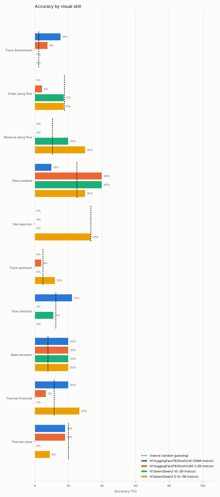

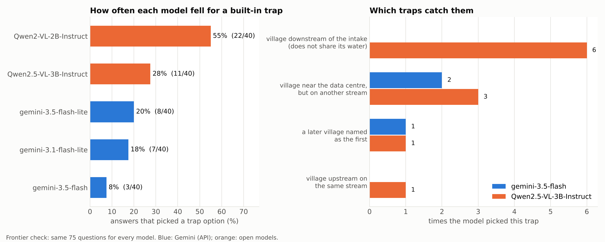

Full tables, fine-tuning and caveats: [docs/FINDINGS.md](docs/FINDINGS.md) · per-run report: [results/models/REPORT.md](results/models/REPORT.md)
<!-- FINDINGS:END -->

## See it

**Live demo (no login): https://yugesh1111.github.io/THIRSTMAP/** · **Human test: https://yugesh1111.github.io/THIRSTMAP/human/** (32 questions Gemini and the open models also answered, all 7 pairs included; send the copied answers to the team, then `python3 human_eval.py score answers_*.txt`)

**Demo:** [`docs/demo/index.html`](docs/demo/index.html) opens with the results, then walks one real scene through every pipeline step, then shows 64 tasks with each open model's real reply, an automatic ✓/✗ and an answer-key reveal, plus before-and-after pairs. It is also in the repo; open the file in a browser, no server needed.

**How a task is made** (one real scene, `level4_seed48947`, from `pipeline_visuals.py`):

| 1 Terrain | 2 Water simulation | 3 Scene script + traps | 4 Answer key |
|---|---|---|---|
| 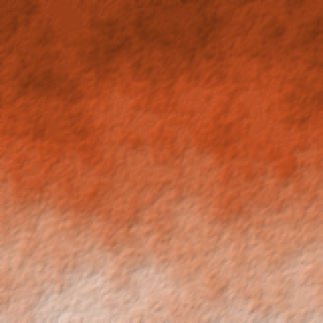 | 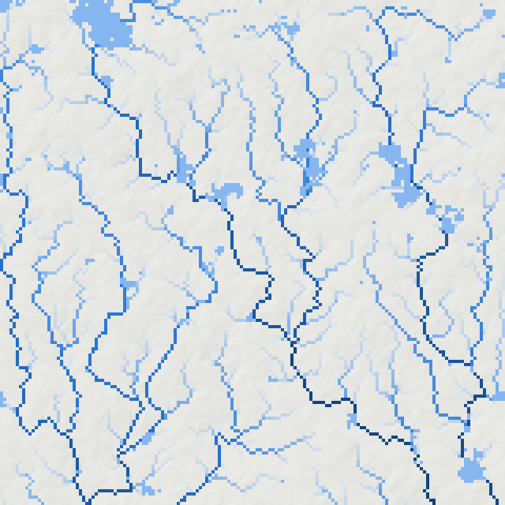 |  | 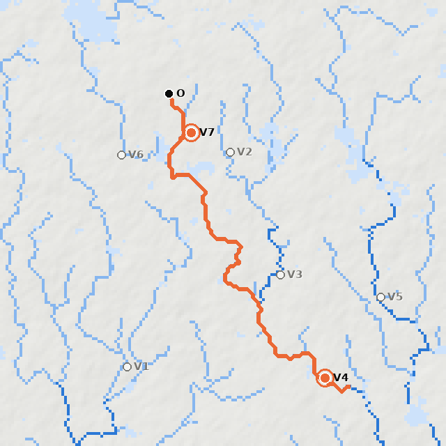 |
| Fractal terrain, 4 × 4 km, 25 m cells | Priority-flood + D8 routing draws the streams | DC-1, outfall O, villages, wetlands; V6 is the near-but-other-stream trap | Traced downhill from O: **V4, V7** |
| **5 Independent check** | **6 Rendered (satellite style)** | **7 Pixel evidence** | **8 Twin** |
| 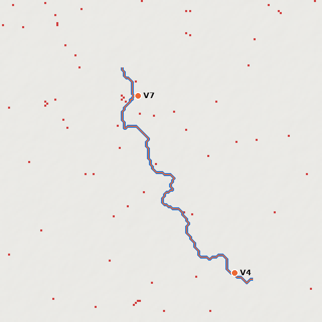 | 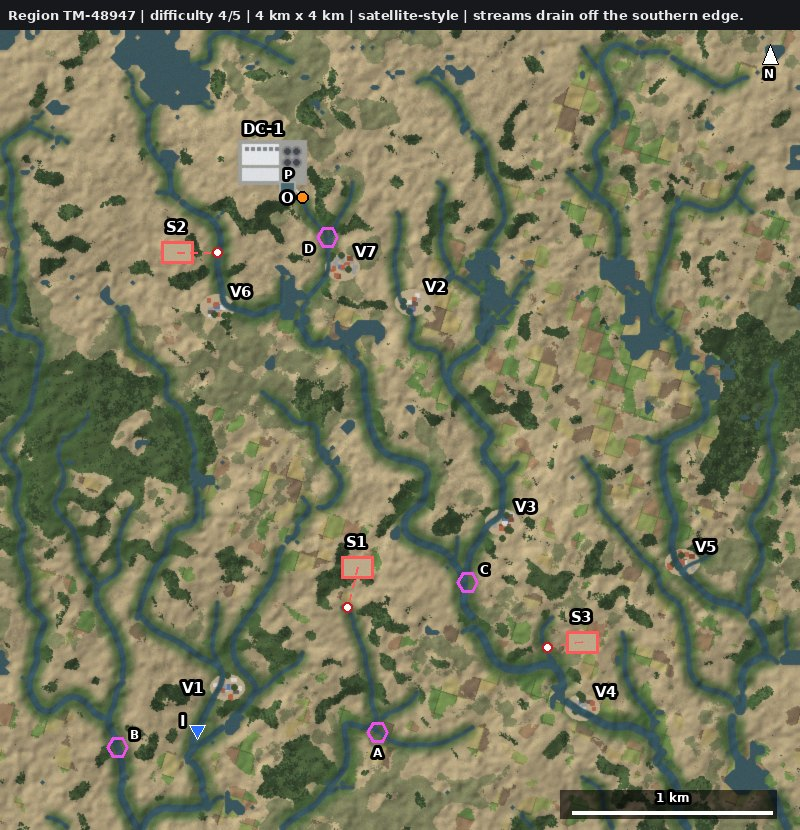 |  | 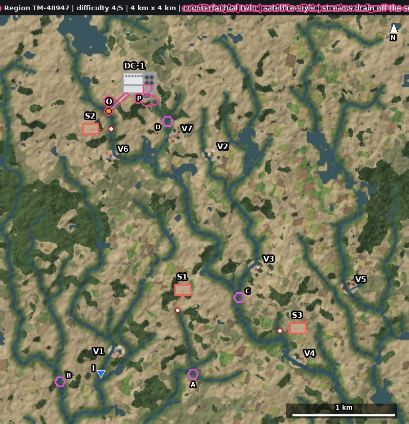 |
| pysheds agrees on 99.73% of cells, same answer to 10/10 questions | Also rendered as topographic map and thermal | 137/137 path cells visible in the pixels | Outfall moved (0.64% of pixels): answer becomes **V4, V6** |

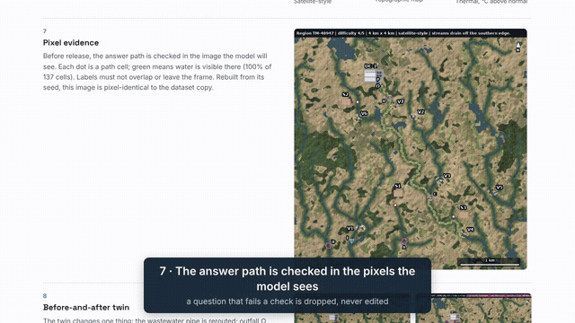

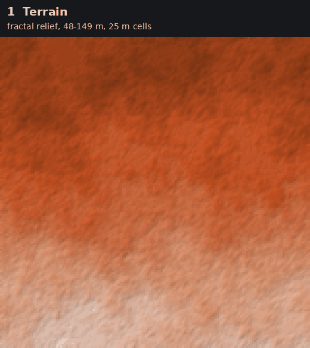

*How a task is made: one real scene through every pipeline step.*

| One scene, three image styles, one answer key | Difficulty dial, level 1 → 5 |
|---|---|
| 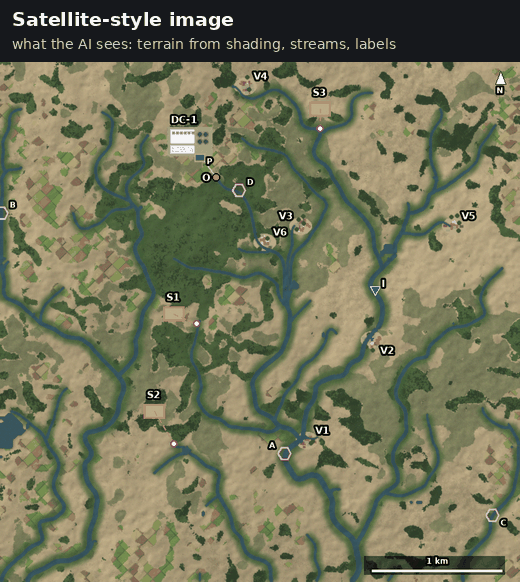 |  |
| **Counterfactual twin: one small change, the answer must flip** | **Appearance variants: the answer must NOT change** |
|  | 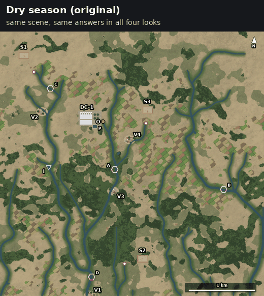 |


*Real terrain (Copernicus elevation + ESA land cover) for four Indian data-centre hubs; the facility and villages are hypothetical.*

## What it produces

For every scene, the **same answer key** is rendered as three image styles:

| 🛰️ Satellite-style | 🗺️ Topographic map | 🌡️ Thermal |
|---|---|---|
| Relief shading, land cover, channels, villages, data-centre roofs and cooling towers | Contours, streams, symbols | Water temperature above normal on a 0–15 °C colour scale |

…and up to **10 question types**. None of them is a counting task:

| Q | Visual skill | Example | Styles |
|---|---|---|---|
| Q1 | Trace downstream | Which villages receive DC-1's wastewater? | sat, map |
| Q2 | Order along a path | Which village receives it first? | sat, map |
| Q3 | Nature-based fix | Which wetland site cleans ALL the wastewater before ANY village? | sat, map |
| Q4 | Read elevation | Which farms lie lower than pond P (gravity reuse)? | map |
| Q5 | Flow direction | Which way does the stream flow below the outfall? | sat, map |
| Q6 | Siting | Which proposed site's wastewater reaches no village? | sat, map |
| Q7 | Trace upstream | Which villages share the water source at intake I? | sat, map |
| Q8 | Colour-scale threshold | At which monitoring points is water > 3 °C warmer? | thermal |
| Q9 | Colour-scale value | How many °C warmer is the water at M2? | thermal |
| Q10 | Measure along a winding path | How far (m) does the wastewater travel along the stream to the first village? | sat, map |

**Traps are built in:** a village on the *same* stream but *upstream*, a village *close* to the data centre but on *another* stream, a wetland placed *after* a village (too late), and monitoring points upstream or on other streams. When a model answers wrong, the scorer names the trap it fell for.

**Counterfactual twins:** for almost every scene (306 of 308), the dataset also contains a **twin with one minimal, visible change that must flip the answer**. The twin is otherwise identical: same terrain, villages and labels (≈0.5% of pixels change). The change rotates between three kinds:

| Twin kind | What changes in the image | Answers that flip |
|---|---|---|
| Outfall moved | The pipe is rerouted and O sits on a different stream | Q1, Q2 |
| Intake moved | Intake I moves to a nearby point, often across a confluence | Q7 |
| Thermal | The cooling water is hotter or cooler (colours only) | Q8, Q9 |

**Pair accuracy** counts a pair only if both versions are answered correctly. It exposes models that answer from habit instead of looking. For example, the offline `mock:stubborn` baseline (it never notices a change) scores **87% on single tasks but 0% pair accuracy**.

**Eye-exam difficulty dial (levels 1–5):** rougher terrain, more ridges, more distractor streams, more villages and a finer contour interval. The report shows each model's **breaking level** per skill.

**Real-terrain mode:** the same pipeline runs on real **Copernicus 30 m elevation + ESA WorldCover land cover** for four Indian data-centre hubs: **Navi Mumbai, Hyderabad, Pune (Hinjewadi) and Chennai (Ambattur)**. Facility placements there are hypothetical.

**Current dataset:** 308 scenes and **5,761 tasks** (4,642 synthetic, 1,119 on real terrain), including **740 counterfactual pairs**; 431 of them (7.5%) are excluded by the self-audit ([`docs/AUDIT.md`](docs/AUDIT.md)), leaving 5,330 scored tasks; 2.1 GB of images. Built in about 18 minutes on 4 CPU cores. The **full dataset** is published as a GitHub Release (three zip parts with SHA-256 checksums, plus its manifest, validation report and verification). The `dataset-release` workflow **rebuilds it from the code on GitHub's own runners** whenever a `dataset-v*` tag is pushed, using the locked versions in `requirements-lock.txt`. A ready-to-use slice ships in the repo as **[`dataset_sample/`](dataset_sample/)**: 28 scenes plus their twins, 529 tasks and 69 pairs, in the same format, so you can run `evaluate.py --dataset dataset_sample` straight away.

---

## How answers are established and validated (independently of any model)

1. **Water simulation:** priority-flood depression filling, then D8 steepest-descent routing, then flow accumulation. Every answer is computed from this.
2. **Every question must pass every relevant check, or it is dropped. Nothing is hand-edited:**

| Check | What it proves |
|---|---|
| **V1** independent recomputation | A third-party library (**pysheds**) re-derives flow directions and every answer. Disagreement means the question is dropped (≈99.9% cell agreement in practice). |
| **V2** known-answer tests | Tilted plane, V-valley, ridge split, bowl-to-lake (`tests/test_hydrology.py`) |
| **V3** counterfactual | Unit test: removing a ridge must change the answer. In the dataset: 740 linked twin pairs whose answers provably differ, each twin independently re-validated (V1–V11) |
| **V4** determinism | Same seed gives byte-identical images and answers |
| **V5/V7/V8** margins | No farm within 3 m of the pond's height, unaffected villages ≥ 5 cells from the path, exactly one correct wetland, no temperature within 0.8 °C of the threshold |
| **V9** pixel evidence | The answer path is checked **in the rendered pixels** of each style |
| **V10** legibility | Labels never overlap and stay inside the image |
| **V10b** labels clear | No option label sits under the scale bar, north arrow or colour legend (added after a self-audit; [`docs/AUDIT.md`](docs/AUDIT.md)) |
| **V11** style applicability | Questions are only asked in styles that contain the evidence |
| **V13** blind baseline | Every question is also asked **without the image**; tasks guessable blind are flagged |
| **V14** answer balance | Correct-answer positions and set sizes are rotated across the dataset |

`dataset/manifest.json` records pass rates and every dropped question with its reason. **[`docs/VALIDATION_REPORT.md`](docs/VALIDATION_REPORT.md)** collects all of the evidence in one place: test results, every validator's pass rate, pysheds agreement (99.85% of cells on average, never below 99.35%), dropped questions, answer balance, counterfactual pairs and baselines. Regenerate it with `python3 validation_report.py`.

**Human baseline (V15):** `python3 human_eval.py build --from-run results/frontier --pairs` writes `human_eval/index.html` (online at https://yugesh1111.github.io/THIRSTMAP/human/): 32 questions that Gemini and the open models also answered, including all 7 before-and-after pairs (kept far apart) and at least 2 per skill, with each question's context line exactly as the models saw it and no answers in the page. People press *Copy my answers* and send the text; `python3 human_eval.py score answers_*.txt --dataset eval_set --run results/frontier` scores them with the models' scorer and puts humans next to each model on the same questions and pairs.

---

## Quick start

One command reproduces everything (tests, dataset, baselines, eye exam, reports, verification, demo):

```bash
./run_all.sh            # full benchmark, about 25 min on 4 cores
./run_all.sh --quick    # small version, about 2 min
```

**Install it as a command** (no clone needed; works anywhere):

```bash
pip install "git+https://github.com/yugesh1111/THIRSTMAP"
thirstmap generate --level 3 --seed 11 --twin --out my_scenes     # one scene + its twin, checked
thirstmap list                                                     # every pipeline stage as a subcommand
```

Each subcommand runs the matching script with the same options (`thirstmap build`, `evaluate`, `report`, `frontier`, `verify`, `human`, …). In the browser instead: [`ThirstMap_quickstart.ipynb`](ThirstMap_quickstart.ipynb) [](https://colab.research.google.com/github/yugesh1111/THIRSTMAP/blob/main/ThirstMap_quickstart.ipynb).

Or run each stage yourself:

```bash
pip install -r requirements.txt
python3 -m pytest -q                                    # 48 tests
python3 generate.py --level 3 --seed 11 --twin          # one scene + its counterfactual twin -> out/
python3 generate.py --level 3 --seed 5 --real navi_mumbai
python3 build_dataset.py --per-level 18 --real-per-location 9 --out dataset --workers 4
python3 evaluate.py --dataset dataset --models mock:oracle mock:random mock:stubborn --blind --run offline_baselines
python3 pipeline_visuals.py --scene level4_seed48947 --out docs/pipeline
python3 build_demo.py --dataset dataset --run results/models --baselines results/offline_baselines --pipeline docs/pipeline --out docs/demo
```

**Free open models, no keys (CPU or GPU):**

```bash
./run_open_models.sh                                           # 4 open models -> results/models/
MODELS="Qwen/Qwen2.5-VL-3B-Instruct" ./run_open_models.sh      # just one
python3 evaluate.py --dataset dataset --models hf:Qwen/Qwen2.5-VL-3B-Instruct --variants 24 --run models
python3 finetune.py --test-run results/models --train-per-q 30 --epochs 2   # can the data teach the skill?
python3 findings.py --run results/models                  # docs/FINDINGS.md + README findings, from the numbers
```

`hf:MODEL_ID[@NNNpx]` runs any Hugging Face image-text-to-text model through `transformers`. Probes (`--probes`) check whether a model can read the labels and colour scale at all, before blaming its reasoning. Variants (`--variants`) ask the same question about the same scene in dry season, monsoon, haze and coarse-sensor looks: the answer must not change.

**Frontier models on a free API tier (request economy):** a free Gemini key allows about 20 requests per model per day, so `frontier.py` asks every question about an image in one request (batch prompting), resizes images to 768 px, keeps a hard request budget per model, stops on a daily-quota error and never re-sends an answered image. The open models get the identical batched prompts and images, so the comparison is like for like.

```bash
python3 frontier.py select --out results/frontier                  # 18 images (6 before-and-after pairs), 89 questions (83 after the audit)
OPENAI_API_KEY=proxy-injected python3 frontier.py run --budget 20 \
    --models "openai:gemini-3.1-flash-lite@https://generativelanguage.googleapis.com/v1beta/openai/"
python3 frontier.py run --models hf:Qwen/Qwen2.5-VL-3B-Instruct      # same prompts, local
```

Evaluating real models (keys are read from the environment, **never stored in code**):

```bash
export ANTHROPIC_API_KEY=...        # or: ant auth login
python3 evaluate.py --dataset dataset --per-cell 3 --blind --run frontier \
    --models claude:claude-opus-5-5 claude:claude-sonnet-5-5 openai:MODEL@BASE_URL gemini:MODEL
```

`--per-cell N` samples N tasks per (question × style × level) cell, so a run covers everything at a predictable cost. Runs resume after interruption. Token usage and cost are recorded per call.

**Adaptive eye exam (cheapest way to find breaking points):**

```bash
python3 staircase.py --dataset dataset --models claude:claude-opus-5-5 --trials 16 --run opus_eye
```

This uses a 2-down/1-up staircase (Levitt 1971): two correct answers in a row make the next task harder, one wrong answer makes it easier. It converges where the model is right about 71% of the time, so lucky guesses can't climb. That's about 144 calls per model instead of about 2,000. Offline check: the oracle scores 5.5 (never fails) on every skill and the random guesser 0.5–1.5.

## Results status (read this first)
- **Open models, real runs:** four free open-weight models from Hugging Face (Qwen2.5-VL-3B, Qwen2-VL-2B, SmolVLM2-2.2B, SmolVLM-256M) were run locally on CPU on the same tasks. Their numbers are in **Findings** above, in [`docs/FINDINGS.md`](docs/FINDINGS.md) and in [`results/models/REPORT.md`](results/models/REPORT.md). Every raw answer is in `results/models/responses.jsonl`.
- **Frontier models, real runs:** Gemini 3.1 Flash-Lite and 3.5 Flash-Lite answered the same 83 questions as two open models (`frontier.py`, within a free API key's 20 requests per model per day), and Gemini 3.5 Flash answered 19 single questions; see [`LEADERBOARD.md`](LEADERBOARD.md). Claude and GPT run with the same harness once keys are available.
- **Offline baselines** (`mock:oracle`, `mock:random`, `mock:stubborn`) test the dataset and the scorer. They are **not model findings**.
- **[`docs/VERIFICATION.md`](docs/VERIFICATION.md)** (from `verify_results.py`, which shares no code with the report) shows:
  - every reported number recomputed independently from the raw responses (exact match);
  - the random baseline at its exact mathematical chance level (14.1% expected vs 13.9% observed, over the 5,330 tasks left after the audit);
  - 10 sampled dataset scenes regenerated **byte-for-byte** from the code and their seeds (10/10);
  - spot-check sheets of random tasks (image, answer key and reveal) for checking by eye.
- **Exact inputs:** [`eval_set/`](eval_set/) holds exactly the tasks and images the models saw: 257 questions, 16 reading checks and 72 appearance variants (594 files, 355 MB), with SHA-256 checksums, answer reveals and the audit's `errata.jsonl`. Repeat any run on identical images with `python3 evaluate.py --dataset eval_set --all --models hf:MODEL_ID --run rerun`.

## Outputs of an evaluation run (`results/<run>/`)
- `REPORT.md`: overall accuracy (with vs. without image), accuracy by skill, **breaking level per skill**, **map vs satellite** consistency, **counterfactual pair accuracy** and "unchanged answer" rate, trap fall rate and error diagnosis, cost
- `chart_accuracy_by_skill.png`, `chart_eye_exam.png`, `chart_by_style.png`
- `summary.json`, `responses.jsonl` (raw answers, parsed answers, scores, error tags, tokens)

## Architecture

```
thirstmap/terrain.py      fractal terrain, priority-flood, D8 routing, accumulation, tracing
thirstmap/scene.py        scene script: data centre, outfall, villages (+traps), wetlands, sites, intake, heat plume
thirstmap/realterrain.py  real Copernicus DEM + ESA WorldCover windows for Indian locations
thirstmap/questions.py    10 question types -> answer key (options, traps, styles)
thirstmap/render_sat.py   satellite-style renderer
thirstmap/render_map.py   topographic map renderer
thirstmap/render_thermal.py thermal false-colour renderer
thirstmap/validate.py     V1–V11 validators (pysheds cross-check, margins, pixel evidence, labels)
thirstmap/counterfactual.py twins: one minimal change (outfall / intake / temperature) that must flip the answer
thirstmap/dataset.py      tasks (question x style) with prompts and scoring rules
thirstmap/models.py       Claude / OpenAI-compatible / Gemini / Hugging Face adapters + offline oracle, random & stubborn baselines
thirstmap/scoring.py      robust answer parsing, scoring (exact / set-F1 / tolerance), error diagnosis
generate.py               scene -> render -> validate -> keep / drop / regenerate
build_dataset.py          parallel batch build + manifest (counts, validation pass rates, answer balance)
evaluate.py, report.py    model runs, metrics, charts, markdown report
build_demo.py             self-contained demo page: results, pipeline walkthrough, tasks with real replies -> ✓/✗ -> answer reveal
pipeline_visuals.py       one scene through every pipeline step (terrain, water, scene, answer, checks, styles, twin)
staircase.py              adaptive eye exam (2-down/1-up) per model x skill
human_eval.py             human baseline page + scorer (same tasks, same scorer)
validation_report.py      collects all validation evidence into docs/VALIDATION_REPORT.md
probes.py                 perception probes: can the model read labels, heights and the colour scale at all?
variants.py               appearance variants (monsoon / haze / coarse sensor) that must not change the answer
run_open_models.sh        four free Hugging Face models, same tasks, no keys
frontier.py               frontier check under a request budget: batched prompts, one-tile images, resume
finetune.py               LoRA fine-tune of a small open model on held-out scenes; base vs tuned
findings.py               writes docs/FINDINGS.md and the README findings from summary.json
publish_eval_set.py       copies exactly the evaluated tasks + images to eval_set/ with checksums
verify_results.py         independent recomputation, chance check, byte-for-byte regeneration
make_gifs.py              the GIFs in this README
```

## Honest limitations
- Synthetic terrain is simplified; D8 routing ignores groundwater, canals, pipes and seasonality.
- The heat plume is a simple decay-and-mixing model, not a hydrodynamic simulation.
- Copernicus DEM is a surface model (includes trees and buildings); we smooth it lightly. Urban flow paths are approximate.
- Real-terrain scenes use hypothetical facilities and villages; we make no claims about real facilities.
- Some impact statistics come from secondary reporting and are estimates (see the brief for sources).
- The OpenAI-compatible and Gemini adapters follow the official SDKs but were not exercised in the build environment (no keys there).
- Reproducibility is byte-for-byte on the same platform. A different machine can build a slightly different (equally valid) dataset because of floating-point and font-rendering details: GitHub's runners built 310 scenes / 5,779 tasks where our machine built 308 / 5,761. That is why the exact evaluated inputs are published in `eval_set/`.
- The open models were small (0.26B–3B parameters) and ran on CPU with greedy decoding; larger models may do much better. The fine-tuning test used images reduced to 512 px.

## Data credits
Copernicus DEM GLO-30 (© DLR e.V. 2010-2014 and © Airbus Defence and Space GmbH 2014-2018, provided under COPERNICUS by the European Union and ESA; all rights reserved), modified · ESA WorldCover 10 m 2021 v200 (CC BY 4.0).
