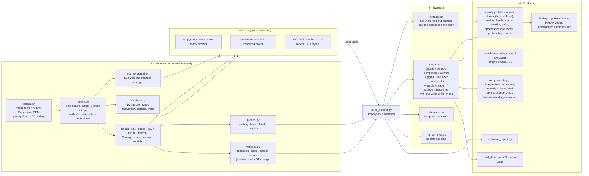

# ThirstMap — architecture

## Data flow in one sentence
A **scene script** (terrain + simulated water + placements) is the single source of truth. Every image is *rendered from* it, every answer is *computed from* it, an *independent library* recomputes the answers, the *rendered pixels* are checked to contain the evidence, and only then is a task released to models.

## Key design decisions
| Decision | Why |
|---|---|
| Answers come from a simulation, not from labels | Exact, reproducible, and nobody can argue with the ground truth |
| Three image styles share one answer key | Separates "understands the land" from "reads map symbols" |
| Drop, never edit | Prevents hand-tuning the benchmark toward a result |
| Independent re-implementation (pysheds) | A bug in our routing can't silently become a "correct" answer |
| Pixel-level evidence checks | "The answer is in the data" is not enough; it must be *visible* |
| Traps and counterfactual twins | Wrong answers are diagnosed, and answering from habit is exposed |
| Balanced answer positions | No "always pick S3" shortcut |
| Adaptive 2-down/1-up exam | Locates breaking points with ~144 calls per model instead of ~2,000 |
| Real-terrain mode | Shows the synthetic findings transfer to real Indian geography |
| Chance computed per task, binomial test | "16%" means nothing without knowing that guessing gives 13% |
| Reading checks (probes) | Separates "cannot see the label" from "cannot reason about the water" |
| Appearance variants | Season, haze and sensor resolution must not change a correct answer |
| Raw replies are the source of truth | The report and demo re-score every raw reply; a second parser re-checks them |
| Publish the exact evaluated inputs | Dataset builds can differ slightly across machines; `eval_set/` removes the doubt |

## Repeatability
- Same seed gives byte-identical images and answers (tested; `verify_results.py` regenerates dataset samples).
- `.github/workflows/ci.yml` (and `.gitlab-ci.yml`) run the tests and a small end-to-end build on every push; `dataset-release.yml` rebuilds the full dataset on GitHub's runners.
- Across machines, floating-point and font details can change a few scenes, so the images the models actually saw are published in `eval_set/` with checksums.
- One command per stage (see README *Quick start*).
