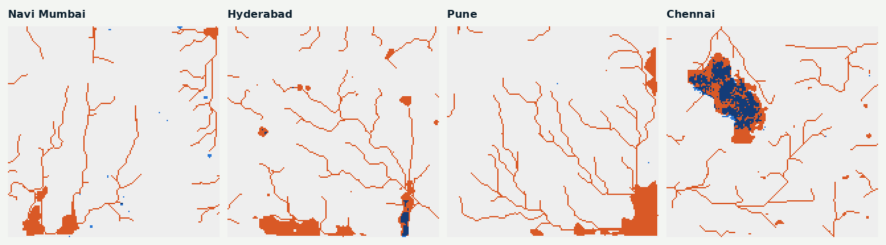

# Realism check: simulated streams vs real water

On real terrain the pipeline simulates drainage from the Copernicus DEM. Here that simulation is compared with ESA WorldCover 2021 permanent water (class 80) on the same 4 × 4 km window and 25 m grid. *Near* = within 50 m of a simulated stream or lake. *Chance* = share of all cells near one, i.e. what real water would score if the simulated network were placed at random. Lift = near / chance.

| Location | Real-water cells | Near a simulated stream or lake | Chance | Lift |
|---|---|---|---|---|
| Navi Mumbai (Mahape / Parsik hills), Maharashtra | 37 | 27% | 21% | 1.3× |
| Hyderabad (Gachibowli / Nanakramguda), Telangana | 97 | 100% | 24% | 4.2× |
| Pune (Hinjewadi / Maan), Maharashtra | 2 | 0% | 26% | 0.0× |
| Chennai (Ambattur / Avadi), Tamil Nadu | 979 | 100% | 27% | 3.6× |

**Where a window holds at least 30 real-water cells (3 of 4 locations), the real water lies within 50 m of the simulated drainage 1.3× to 4.2× as often as random placement would give.** Pune: too little mapped open water to judge.

Limits: WorldCover maps open water at 10 m, so small streams and drains are often absent from it, and the DEM is a surface model (buildings and trees included), lightly smoothed. Facilities and villages in real-terrain scenes are hypothetical; only the land and its drainage are real.
