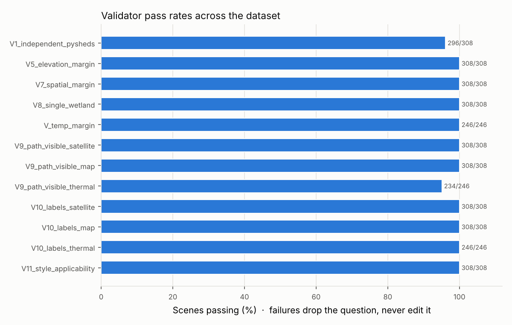
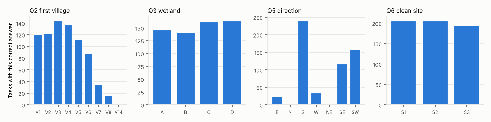

# ThirstMap — validation evidence

Dataset: **308 scenes, 5761 tasks** (synthetic: 4642, navi_mumbai: 255, hyderabad: 286, pune: 294, chennai: 284); built in 1064.8 s. Generated by `build_dataset.py`; this report by `validation_report.py`.

## 1. Automated tests

**37 passed, 1 skipped in 24.69s**

- ✅ `tests/test_counterfactual.py::test_twin_changes_one_thing_and_flips_answers[outfall-11]`
- ✅ `tests/test_counterfactual.py::test_twin_changes_one_thing_and_flips_answers[outfall-23]`
- ✅ `tests/test_counterfactual.py::test_twin_changes_one_thing_and_flips_answers[outfall-42]`
- ✅ `tests/test_counterfactual.py::test_twin_changes_one_thing_and_flips_answers[outfall-77]`
- ✅ `tests/test_counterfactual.py::test_twin_changes_one_thing_and_flips_answers[intake-11]`
- ✅ `tests/test_counterfactual.py::test_twin_changes_one_thing_and_flips_answers[intake-23]`
- ✅ `tests/test_counterfactual.py::test_twin_changes_one_thing_and_flips_answers[intake-42]`
- ✅ `tests/test_counterfactual.py::test_twin_changes_one_thing_and_flips_answers[intake-77]`
- ✅ `tests/test_counterfactual.py::test_twin_changes_one_thing_and_flips_answers[thermal-11]`
- ✅ `tests/test_counterfactual.py::test_twin_changes_one_thing_and_flips_answers[thermal-42]`
- ✅ `tests/test_counterfactual.py::test_twin_changes_one_thing_and_flips_answers[thermal-77]`
- ✅ `tests/test_dataset.py::test_task_records_are_complete_and_images_exist`
- ✅ `tests/test_dataset.py::test_counterfactual_pairs_are_linked_and_flip`
- ✅ `tests/test_hydrology.py::test_tilted_plane_flows_straight_south`
- ✅ `tests/test_hydrology.py::test_v_valley_collects_everything`
- ✅ `tests/test_hydrology.py::test_ridge_keeps_water_on_its_own_side`
- ✅ `tests/test_hydrology.py::test_counterfactual_removing_ridge_changes_answer`
- ✅ `tests/test_hydrology.py::test_bowl_fills_into_lake_and_spills_south`
- ✅ `tests/test_hydrology.py::test_every_cell_drains_out`
- ✅ `tests/test_pipeline.py::test_same_seed_gives_identical_outputs`
- ✅ `tests/test_pipeline.py::test_answer_key_properties[1-3]`
- ✅ `tests/test_pipeline.py::test_answer_key_properties[2-8]`
- ✅ `tests/test_pipeline.py::test_answer_key_properties[3-21]`
- ✅ `tests/test_pipeline.py::test_answer_key_properties[4-34]`
- ✅ `tests/test_pipeline.py::test_answer_key_properties[5-55]`
- ✅ `tests/test_pipeline.py::test_independent_implementation_agrees[1-4]`
- ✅ `tests/test_pipeline.py::test_independent_implementation_agrees[3-12]`
- ✅ `tests/test_pipeline.py::test_independent_implementation_agrees[5-77]`
- ✅ `tests/test_pipeline.py::test_generated_scene_passes_validation`
- ✅ `tests/test_scoring.py::test_set_formats`
- ✅ `tests/test_scoring.py::test_set_partial_credit_and_trap_diagnosis`
- ✅ `tests/test_scoring.py::test_choice_and_direction`
- ✅ `tests/test_scoring.py::test_number_tolerance`
- ✅ `tests/test_scoring.py::test_unparseable`
- ✅ `tests/test_staircase.py::test_perfect_model_never_breaks`
- ✅ `tests/test_staircase.py::test_model_breaking_above_level_2_is_located`
- ✅ `tests/test_staircase.py::test_always_wrong_model_sinks`

## 2. Validators on every generated scene

A question is kept only if every check relevant to it passes; failing questions are dropped and failing scenes regenerated. **Nothing is edited by hand.**

| Check | What it proves | Pass |
|---|---|---|
| V1_independent_pysheds | Every answer re-derived with a third-party hydrology library (pysheds) must match | 296/308 |
| V5_elevation_margin | No farm within 3 m of the pond's height (gravity question) | 308/308 |
| V7_spatial_margin | Unaffected villages are at least 5 cells from the wastewater path | 308/308 |
| V8_single_wetland | Exactly one wetland site cleans the water before any village | 308/308 |
| V_temp_margin | No monitoring point within 0.8 °C of the 3 °C threshold | 246/246 |
| V9_path_visible_satellite | The answer path is visible in the satellite image's pixels | 308/308 |
| V9_path_visible_map | The answer path is visible in the map's pixels | 308/308 |
| V9_path_visible_thermal | The plume is visible in the thermal image's pixels with the right colour | 234/246 |
| V10_labels_satellite | Labels inside the image and never overlapping (satellite) | 308/308 |
| V10_labels_map | Labels inside the image and never overlapping (map) | 308/308 |
| V10_labels_thermal | Labels inside the image and never overlapping (thermal) | 246/246 |
| V11_style_applicability | Each question is only asked in image styles that contain its evidence | 308/308 |

### Independent implementation (V1)

Flow directions recomputed by **pysheds** agree with ours on **99.85%** of cells on average (minimum 99.35%, over 614 scenes incl. counterfactual twins). Disagreements are ties between equally steep neighbours; any question whose answer they change is dropped.

### Dropped questions (and why)

| Question: reason | Count |
|---|---|
| Q8: V9 evidence not visible in any style | 12 |
| Q9: V9 evidence not visible in any style | 12 |
| Q1: V1 mismatch with independent implementation | 4 |
| Q8: V1 mismatch with independent implementation | 3 |
| Q7: V1 mismatch with independent implementation | 2 |
| Q9: V1 mismatch with independent implementation | 2 |
| Q5: V1 mismatch with independent implementation | 2 |
| Q6: V1 mismatch with independent implementation | 1 |
| Q3: V1 mismatch with independent implementation | 1 |

Scenes that never passed validation (recorded, not patched): 2

## 3. Answer balance (no answer position is favoured)

Set-valued answers by size: Q1: 1→87, 2→534, 3→138, 4→8; Q4: 0→19, 1→69, 2→76, 3→75, 4→39, 5→21, 6→9; Q7: 1→710, 2→168, 3→36; Q8: 0→66, 1→135, 2→103, 3→1

## 4. Counterfactual pairs

306 scenes have a twin with one minimal change that must flip the answer; **740 linked pairs** (by kind: {'outfall': 80, 'intake': 151, 'thermal': 75}). Each twin is validated independently, and a pair is only kept if the reference answers differ.

## 5. Baselines (does scoring separate right from wrong? can tasks be guessed?)

| Baseline | Accuracy | Without image | Pair accuracy |
|---|---|---|---|
| mock:oracle | 100% | 100% | 100% |
| mock:random | 14% | 14% | 1% |
| mock:stubborn | 87% | 87% | 0% |

- **oracle** = 100%: the scorer accepts every correct answer, in every format variant tested.
- **random** ≈ chance: per skill order_along_flow: 18%, nature_based_filtering: 24%, trace_downstream: 3%, measure_along_flow: 11%, read_flow_direction: 11%, siting_downstream_impact: 33%, read_elevation: 5%, read_colour_scale_threshold: 11%, read_colour_scale_value: 22%, trace_upstream_catchment: 4%.
- **stubborn** (never notices a change) looks strong on single tasks but scores 0% pair accuracy: the pairs expose answering from habit.

## 6. Known limitations

- Synthetic terrain and D8 routing simplify real hydrology (no groundwater, canals, pipes or seasons).
- The heat plume is a decay-and-mixing model; real plumes depend on flow rates and weather.
- Real-terrain scenes use a lightly smoothed surface model and hypothetical facilities.
- Human solvability (V15) is measured with `human_eval/` — results are added when collected.
