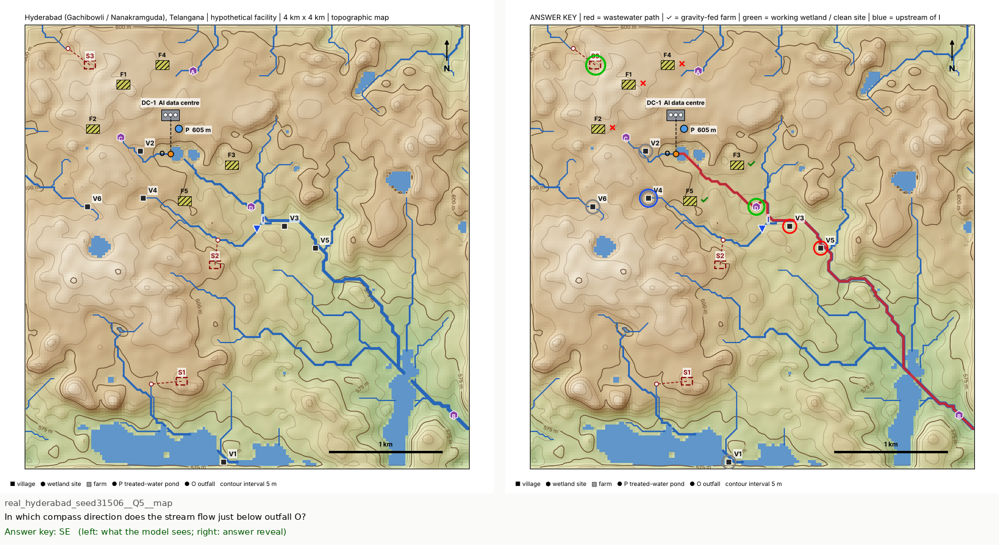
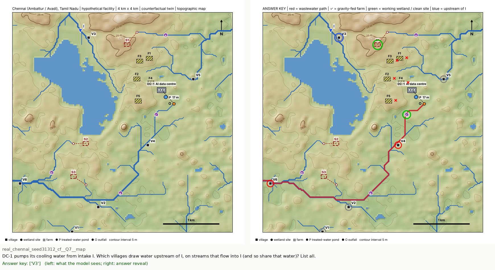
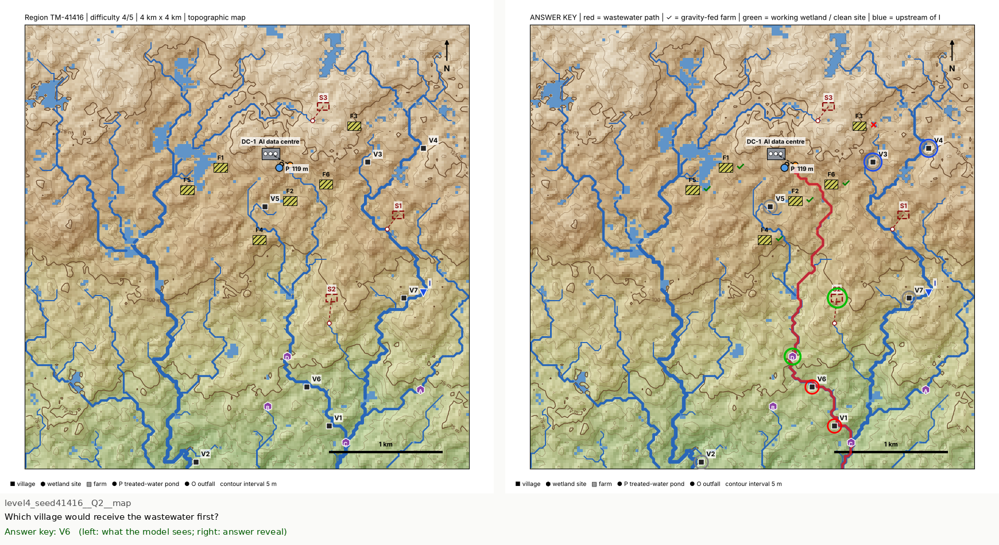

# Independent verification

This file is produced by `verify_results.py`, which does not reuse the report or scoring code.

> **Important:** the models named `mock:*` are offline *baselines* used to test the dataset and the
> scorer: `oracle` returns the answer key, `random` picks random options, `stubborn` repeats the
> original answer on counterfactual twins. They are **not** AI models. No frontier model has been
> evaluated yet; their results will be added when API access is available.

## 1. Reported accuracies recomputed from raw responses

| Model | Mode | Responses | Recomputed | In summary.json | Match |
|---|---|---|---|---|---|
| mock:oracle | blind | 2097 | 100.00% | 100.00% | ✅ |
| mock:oracle | image | 2097 | 100.00% | 100.00% | ✅ |
| mock:random | blind | 2097 | 12.35% | 12.35% | ✅ |
| mock:random | image | 2097 | 13.92% | 13.92% | ✅ |
| mock:stubborn | blind | 2097 | 85.31% | 85.31% | ✅ |
| mock:stubborn | image | 2097 | 85.31% | 85.31% | ✅ |

**All reported accuracies reproduced exactly: yes.**

## 2. Random baseline vs exact chance

Expected correct by pure chance (computed from each task's options): **292.5** of 2097 (13.9%). Observed: **292** (13.9%). Difference = -0.03 standard deviations (consistent with chance).

| Question type | Tasks | Expected | Observed |
|---|---|---|---|
| Q1 | 319 | 2.5% | 2.8% |
| Q2 | 321 | 16.9% | 18.7% |
| Q3 | 250 | 25.0% | 22.8% |
| Q4 | 125 | 5.1% | 3.2% |
| Q5 | 238 | 12.5% | 10.5% |
| Q6 | 244 | 33.3% | 33.2% |
| Q7 | 362 | 4.3% | 4.4% |
| Q8 | 124 | 9.7% | 11.3% |
| Q9 | 114 | 20.0% | 22.8% |

## 3. Dataset regenerated from recorded seeds

| Scene | Answer key identical | Images identical |
|---|---|---|
| level1_seed36316 | ✅ | ✅ (6 images) |
| level3_seed32088 | ✅ | ✅ (6 images) |
| level4_seed49917 | ✅ | ✅ (4 images) |
| level4_seed56963 | ✅ | ✅ (4 images) |
| level5_seed68425 | ✅ | ✅ (6 images) |
| level1_seed35055 | ✅ | ✅ (6 images) |

**6/6 sampled scenes regenerated byte-for-byte from code + seed.**

## 4. Spot-check sheets

Six random tasks: what the model sees (left) next to the answer reveal (right), with the question and key.

