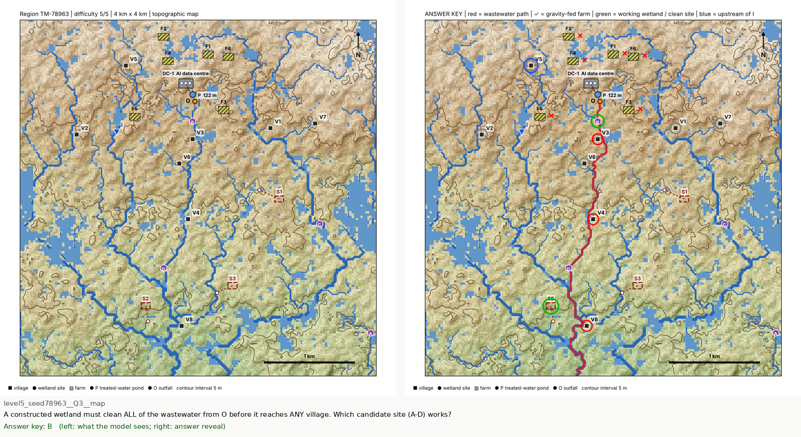

# Independent verification

This file is produced by `verify_results.py`, which does not reuse the report code and checks the scorer with parsers of its own.

> **Important:** the models named `mock:*` are offline *baselines* used to test the dataset and the
> scorer: `oracle` returns the answer key, `random` picks random options, `stubborn` repeats the
> original answer on counterfactual twins. They are **not** AI models. Real open-weight models are
> checked in section 1b, open models and Gemini alike.

## 1. Reported accuracies recomputed from raw responses

| Model | Mode | Responses | Recomputed | In summary.json | Match |
|---|---|---|---|---|---|
| mock:oracle | blind | 5330 | 100.00% | 100.00% | ✅ |
| mock:oracle | image | 5330 | 100.00% | 100.00% | ✅ |
| mock:random | blind | 5330 | 14.37% | 14.37% | ✅ |
| mock:random | image | 5330 | 13.88% | 13.88% | ✅ |
| mock:stubborn | blind | 5330 | 87.75% | 87.75% | ✅ |
| mock:stubborn | image | 5330 | 87.75% | 87.75% | ✅ |

**All reported accuracies reproduced exactly: yes.**

## 2. Random baseline vs exact chance

Expected correct by pure chance (computed from each task's options): **752.3** of 5330 (14.1%). Observed: **740** (13.9%). Difference = -0.51 standard deviations (consistent with chance).

| Question type | Tasks | Expected | Observed |
|---|---|---|---|
| Q1 | 664 | 2.6% | 3.3% |
| Q2 | 672 | 17.4% | 17.7% |
| Q3 | 571 | 25.0% | 24.0% |
| Q4 | 302 | 4.8% | 5.0% |
| Q5 | 566 | 12.5% | 11.3% |
| Q6 | 596 | 33.3% | 32.9% |
| Q7 | 804 | 4.4% | 3.7% |
| Q8 | 279 | 10.0% | 11.5% |
| Q9 | 272 | 20.0% | 22.1% |
| Q10 | 604 | 12.2% | 10.8% |

## 1b. Real model answers (results/models)

These are free-text replies from real models, so a second parser, written separately from the project's scorer, re-reads every raw reply. *Agreement* is how often the two parsers reach the same verdict; disagreements are listed so they can be judged by eye.

Compared on the 130 tasks that every model answered with the image.

| Model | Mode | Replies | Project scorer on raw replies | In summary.json | Second parser | Agreement |
|---|---|---|---|---|---|---|
| hf:HuggingFaceTB/SmolVLM-256M-Instruct | blind | 130 | 10.0% | 10.0% ✅ | 10.0% | 100.0% |
| hf:HuggingFaceTB/SmolVLM-256M-Instruct | image | 130 | 8.5% | 8.5% ✅ | 9.2% | 99.2% |
| hf:HuggingFaceTB/SmolVLM2-2.2B-Instruct | blind | 130 | 11.5% | 11.5% ✅ | 11.5% | 100.0% |
| hf:HuggingFaceTB/SmolVLM2-2.2B-Instruct | image | 130 | 8.5% | 8.5% ✅ | 8.5% | 100.0% |
| hf:Qwen/Qwen2-VL-2B-Instruct | blind | 130 | 9.2% | 9.2% ✅ | 9.2% | 100.0% |
| hf:Qwen/Qwen2-VL-2B-Instruct | image | 130 | 9.2% | 9.2% ✅ | 9.2% | 100.0% |
| hf:Qwen/Qwen2.5-VL-3B-Instruct | blind | 130 | 13.8% | 13.8% ✅ | 13.8% | 100.0% |
| hf:Qwen/Qwen2.5-VL-3B-Instruct | image | 130 | 16.9% | 16.9% ✅ | 16.9% | 100.0% |

**1 replies where the two parsers disagree** (first 12):

| Model | Task | Key | Raw reply | Project scorer |
|---|---|---|---|---|
| SmolVLM-256M-Instruct | level5_seed76732_cf__Q8__thermal | [] | `{ "answer": [["V1", "V4"], ["M1", "M2"]]}` | wrong |

Ten random raw replies, exactly as the models wrote them:

| Model | Task | Key | Raw reply | Scored |
|---|---|---|---|---|
| SmolVLM-256M-Instruct | level4_seed51954__Q8__thermal | ['M2', 'M3'] | `{ "answer": [ { "label": "V6", "value": "v6" }, { "label": "V2", "value": "v2" }, {` | ❌ |
| Qwen2-VL-2B-Instruct | level1_seed12850__Q2__satellite | V1 | `{"answer": "S1"}` | ❌ |
| SmolVLM2-2.2B-Instruct | level1_seed91943__Q10__satellite | 690 | `1` | ❌ |
| Qwen2.5-VL-3B-Instruct | real_pune_seed47441__Q5__satellite | SE | `{"answer": "E"}` | ❌ |
| Qwen2.5-VL-3B-Instruct | level2_seed48554__Q9__thermal | 6.3 | `{"answer": 10}` | ❌ |
| Qwen2-VL-2B-Instruct | real_chennai_seed31506__Q10__satellite | 590 | `{"answer": 1000}` | ❌ |
| Qwen2.5-VL-3B-Instruct | level4_seed48947__Q1__satellite | ['V4', 'V7'] | `{"answer": ["V2"]}` | ❌ |
| SmolVLM-256M-Instruct | level3_seed31894__Q2__satellite | V3 | `V2` | ❌ |
| Qwen2.5-VL-3B-Instruct | level4_seed68374__Q6__satellite | S2 | ````json {"answer": "S2"} ```` | ✅ |
| SmolVLM2-2.2B-Instruct | level2_seed32910_cf__Q8__thermal | [] | `{"answer": ["M1", "M2", "M3", "M4"]}` | ❌ |

## 1b. Real model answers (results/frontier)

These are free-text replies from real models, so a second parser, written separately from the project's scorer, re-reads every raw reply. *Agreement* is how often the two parsers reach the same verdict; disagreements are listed so they can be judged by eye.

Compared on the 75 tasks that every model answered with the image.

| Model | Mode | Replies | Project scorer on raw replies | In summary.json | Second parser | Agreement |
|---|---|---|---|---|---|---|
| hf:Qwen/Qwen2-VL-2B-Instruct | blind | 75 | 10.7% | 10.7% ✅ | 10.7% | 100.0% |
| hf:Qwen/Qwen2-VL-2B-Instruct | image | 75 | 5.3% | 5.3% ✅ | 5.3% | 100.0% |
| hf:Qwen/Qwen2.5-VL-3B-Instruct | blind | 75 | 12.0% | 12.0% ✅ | 12.0% | 100.0% |
| hf:Qwen/Qwen2.5-VL-3B-Instruct | image | 75 | 12.0% | 12.0% ✅ | 12.0% | 100.0% |
| openai:gemini-3.1-flash-lite | blind | 71 | 12.7% | 12.7% ✅ | 12.7% | 100.0% |
| openai:gemini-3.1-flash-lite | image | 75 | 49.3% | 49.3% ✅ | 49.3% | 100.0% |
| openai:gemini-3.5-flash | image | 75 | 76.0% | 76.0% ✅ | 76.0% | 100.0% |
| openai:gemini-3.5-flash-lite | blind | 75 | 14.7% | 14.7% ✅ | 14.7% | 100.0% |
| openai:gemini-3.5-flash-lite | image | 75 | 40.0% | 40.0% ✅ | 40.0% | 100.0% |

Ten random raw replies, exactly as the models wrote them:

| Model | Task | Key | Raw reply | Scored |
|---|---|---|---|---|
| openai:gemini-3.5-flash-lite | level4_seed48947__Q10__map | 390 | `{"answer": 1200}` | ❌ |
| openai:gemini-3.1-flash-lite | level4_seed48947__Q3__map | D | `{"answer": "D"}` | ✅ |
| Qwen2.5-VL-3B-Instruct | level3_seed31409__Q2__map | V6 | `` | ❌ |
| openai:gemini-3.5-flash | level2_seed22760__Q2__map | V5 | `{"answer": "V5"}` | ✅ |
| openai:gemini-3.1-flash-lite | level4_seed58903__Q10__map | 2550 | `{"answer": 3400}` | ❌ |
| openai:gemini-3.1-flash-lite | level3_seed31409__Q3__map | D | `{"answer": "D"}` | ✅ |
| Qwen2-VL-2B-Instruct | level4_seed58903_cf__Q1__map | ['V5'] | `{"answer": ["V1", "V2", "V3", "V4", "V5"]}` | ❌ |
| openai:gemini-3.1-flash-lite | level5_seed52684__Q6__satellite | S3 | `{"answer": "S2"}` | ❌ |
| Qwen2.5-VL-3B-Instruct | level4_seed58903__Q5__map | S | `{"answer": "E"}` | ❌ |
| Qwen2-VL-2B-Instruct | level5_seed52684__Q7__satellite | ['V1'] | `{"answer": ["V1", "V4"]}` | ❌ |

## 3. Dataset regenerated from recorded seeds

| Scene | Answer key identical | Images identical |
|---|---|---|

**0/0 sampled scenes regenerated byte-for-byte from code + seed.**

## 4. Spot-check sheets

Six random tasks: what the model sees (left) next to the answer reveal (right), with the question and key.





