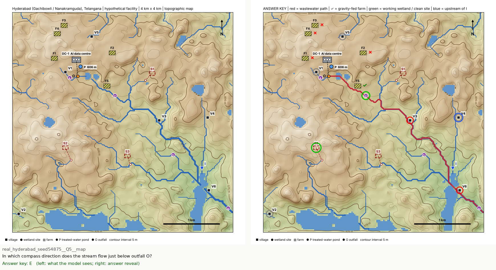
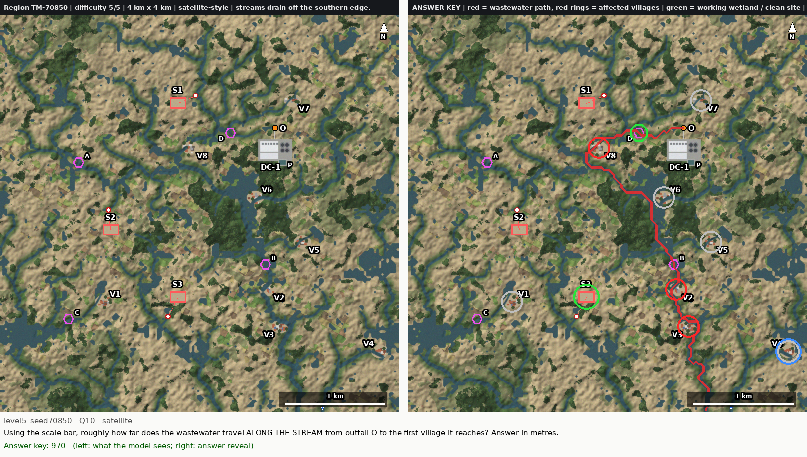

# Independent verification

This file is produced by `verify_results.py`, which does not reuse the report or scoring code.

> **Important:** the models named `mock:*` are offline *baselines* used to test the dataset and the
> scorer: `oracle` returns the answer key, `random` picks random options, `stubborn` repeats the
> original answer on counterfactual twins. They are **not** AI models. No frontier model has been
> evaluated yet; their results will be added when API access is available.

## 1. Reported accuracies recomputed from raw responses

| Model | Mode | Responses | Recomputed | In summary.json | Match |
|---|---|---|---|---|---|
| mock:oracle | blind | 5761 | 100.00% | 100.00% | ✅ |
| mock:oracle | image | 5761 | 100.00% | 100.00% | ✅ |
| mock:random | blind | 5761 | 13.97% | 13.97% | ✅ |
| mock:random | image | 5761 | 13.68% | 13.68% | ✅ |
| mock:stubborn | blind | 5761 | 87.16% | 87.16% | ✅ |
| mock:stubborn | image | 5761 | 87.16% | 87.16% | ✅ |

**All reported accuracies reproduced exactly: yes.**

## 2. Random baseline vs exact chance

Expected correct by pure chance (computed from each task's options): **796.4** of 5761 (13.8%). Observed: **788** (13.7%). Difference = -0.33 standard deviations (consistent with chance).

| Question type | Tasks | Expected | Observed |
|---|---|---|---|
| Q1 | 767 | 2.6% | 3.4% |
| Q2 | 775 | 17.2% | 17.7% |
| Q3 | 614 | 25.0% | 23.8% |
| Q4 | 308 | 4.9% | 4.9% |
| Q5 | 578 | 12.5% | 11.2% |
| Q6 | 606 | 33.3% | 32.8% |
| Q7 | 914 | 4.3% | 4.0% |
| Q8 | 305 | 9.8% | 10.8% |
| Q9 | 278 | 20.0% | 21.9% |
| Q10 | 616 | 12.3% | 11.2% |

## 3. Dataset regenerated from recorded seeds

| Scene | Answer key identical | Images identical |
|---|---|---|
| level1_seed26942 | ✅ | ✅ (6 images) |
| level2_seed38986 | ✅ | ✅ (6 images) |
| level3_seed42820 | ✅ | ✅ (6 images) |
| level5_seed77508 | ✅ | ✅ (4 images) |
| level3_seed43499 | ✅ | ✅ (6 images) |
| level4_seed44326 | ✅ | ✅ (6 images) |
| level5_seed59342 | ✅ | ✅ (6 images) |
| level1_seed22224 | ✅ | ✅ (6 images) |
| level5_seed61312 | ✅ | ✅ (6 images) |
| level2_seed23245 | ✅ | ✅ (4 images) |

**10/10 sampled scenes regenerated byte-for-byte from code + seed.**

## 4. Spot-check sheets

Six random tasks: what the model sees (left) next to the answer reveal (right), with the question and key.

