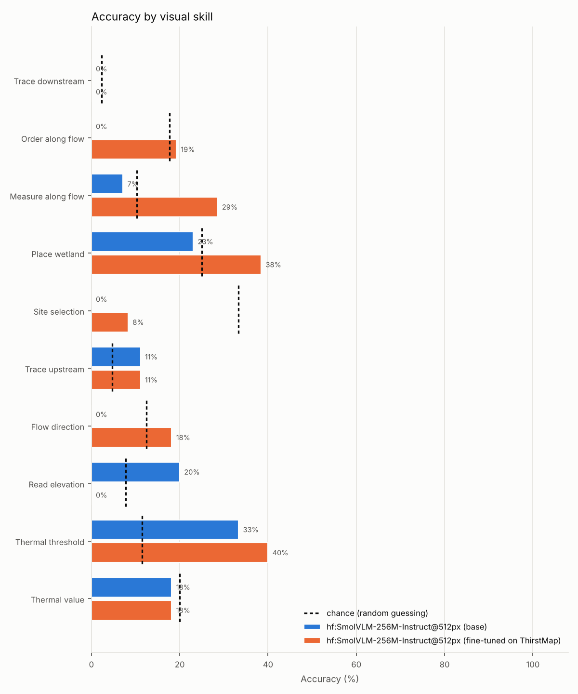
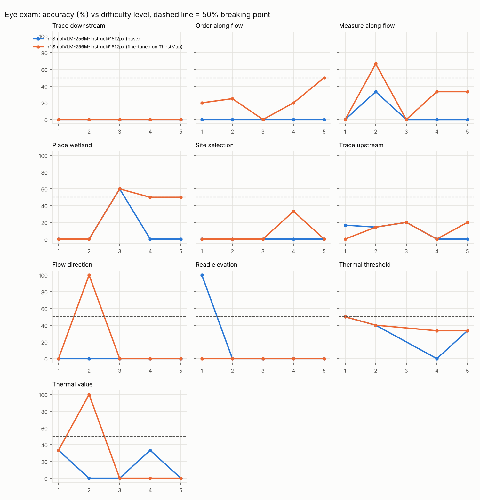

# ThirstMap evaluation report

## Overall

| Model | With image | Without image (blind) | Tasks |
|---|---|---|---|
| hf:SmolVLM-256M-Instruct@512px (base) | 10% | 11% | 150 |
| hf:SmolVLM-256M-Instruct@512px (fine-tuned on ThirstMap) | 19% | 11% | 150 |

18 evaluated tasks are left out of every number here: the dataset audit found them unfair (an option label under the scale bar, north arrow or legend, or a malformed scene; docs/AUDIT.md).

## Better than guessing?

Chance = expected accuracy of a random guesser on exactly these tasks (from each task's options). p = one-sided binomial test that the model beats chance.

| Model | Correct | Accuracy | Chance | p-value |
|---|---|---|---|---|
| hf:SmolVLM-256M-Instruct@512px (base) | 15/150 | 10% | 14% | 0.93 |
| hf:SmolVLM-256M-Instruct@512px (fine-tuned on ThirstMap) | 28/150 | 19% | 14% | 0.056 |

### Strict check: well-formed replies only

The scorer is lenient: it accepts a correct answer even when the reply is badly formatted. Counting a reply as right only if it is also well-formed (JSON with "answer", or a plain JSON value):

| Model | Well-formed replies | Accuracy (all) | Accuracy (well-formed only) |
|---|---|---|---|
| hf:SmolVLM-256M-Instruct@512px (base) | 1% | 10% | 0% |
| hf:SmolVLM-256M-Instruct@512px (fine-tuned on ThirstMap) | 99% | 19% | 19% |

## Accuracy by visual skill

Tasks = distinct tasks per skill (every model answers the same ones); with 10-30 tasks per skill, differences of a few points are within noise.

| Skill | Tasks | Chance | hf:SmolVLM-256M-Instruct@512px (base) | hf:SmolVLM-256M-Instruct@512px (fine-tuned on ThirstMap) |
|---|---|---|---|---|
| Trace downstream | 16 | 2% | 0% | 0% |
| Order along flow | 26 | 18% | 0% | 19% |
| Measure along flow | 14 | 10% | 7% | 29% |
| Place wetland | 13 | 25% | 23% | 38% |
| Site selection | 12 | 33% | 0% | 8% |
| Trace upstream | 27 | 5% | 11% | 11% |
| Flow direction | 11 | 12% | 0% | 18% |
| Read elevation | 5 | 8% | 20% | 0% |
| Thermal threshold | 15 | 11% | 33% | 40% |
| Thermal value | 11 | 20% | 18% | 18% |

## Eye exam: breaking level (first difficulty where accuracy < 50%)

| Skill | hf:SmolVLM-256M-Instruct@512px (base) | hf:SmolVLM-256M-Instruct@512px (fine-tuned on ThirstMap) |
|---|---|---|
| Trace downstream | 1 | 1 |
| Order along flow | 1 | 1 |
| Measure along flow | 1 | 1 |
| Place wetland | 1 | 1 |
| Site selection | 1 | 1 |
| Trace upstream | 1 | 1 |
| Flow direction | 1 | 1 |
| Read elevation | 2 | 1 |
| Thermal threshold | 2 | 2 |
| Thermal value | 1 | 1 |

## Map vs satellite (same scene, same question)

| Model | Pairs | Both right | Only map right | Only satellite right | Both wrong |
|---|---|---|---|---|---|

## Counterfactual pairs (one minimal change that must flip the answer)

Pair accuracy counts a pair only if BOTH the original and its twin are answered correctly. 'Unchanged answer' = the model gave the same answer to both, although the correct answer changed.

| Model | Pairs | Single-task accuracy | Pair accuracy | Unchanged answer |
|---|---|---|---|---|
| hf:SmolVLM-256M-Instruct@512px (base) | 26 | 19% | 0% | 77% |
| hf:SmolVLM-256M-Instruct@512px (fine-tuned on ThirstMap) | 26 | 23% | 0% | 92% |

## Traps and error diagnosis

| Model | Trap tasks | Fell for a trap | Most common errors |
|---|---|---|---|
| hf:SmolVLM-256M-Instruct@512px (base) | 97 | 21% | missed_some (50), unparseable_or_no_answer (47), extra_unrelated (15), underestimate (14) |
| hf:SmolVLM-256M-Instruct@512px (fine-tuned on ThirstMap) | 97 | 34% | missed_some (44), wrong_choice (26), extra_unrelated (24), trap:downstream_not_upstream (16) |

Tasks a majority of real models answered correctly WITHOUT the image: 0

## Cost

| Model | Input tokens | Output tokens | USD | Mean latency (s) |
|---|---|---|---|---|
| hf:SmolVLM-256M-Instruct@512px (base) | 0 | 0 | 0 | 1.5 |
| hf:SmolVLM-256M-Instruct@512px (fine-tuned on ThirstMap) | 0 | 0 | 0 | 0.94 |

