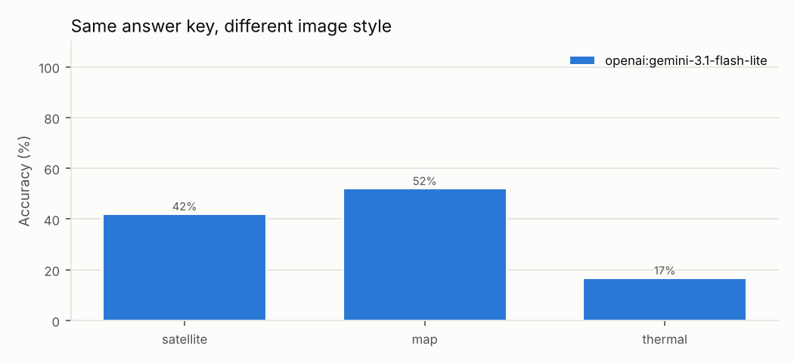

# ThirstMap evaluation report

## Overall

| Model | With image | Without image (blind) | Tasks |
|---|---|---|---|
| openai:gemini-3.1-flash-lite | 46% | – | 89 |

## Better than guessing?

Chance = expected accuracy of a random guesser on exactly these tasks (from each task's options). p = one-sided binomial test that the model beats chance.

| Model | Correct | Accuracy | Chance | p-value |
|---|---|---|---|---|
| openai:gemini-3.1-flash-lite | 41/89 | 46% | 14% | 1.4e-13 |

### Strict check: well-formed replies only

The scorer is lenient: it accepts a correct answer even when the reply is badly formatted. Counting a reply as right only if it is also well-formed (JSON with "answer", or a plain JSON value):

| Model | Well-formed replies | Accuracy (all) | Accuracy (well-formed only) |
|---|---|---|---|
| openai:gemini-3.1-flash-lite | 100% | 46% | 46% |

## Accuracy by visual skill

Tasks = distinct tasks per skill (every model answers the same ones); with 10-30 tasks per skill, differences of a few points are within noise.

| Skill | Tasks | Chance | openai:gemini-3.1-flash-lite |
|---|---|---|---|
| Trace downstream | 12 | 2% | 42% |
| Order along flow | 12 | 16% | 58% |
| Measure along flow | 10 | 13% | 30% |
| Place wetland | 10 | 25% | 90% |
| Site selection | 10 | 33% | 20% |
| Trace upstream | 13 | 3% | 31% |
| Flow direction | 10 | 12% | 70% |
| Read elevation | 6 | 4% | 50% |
| Thermal threshold | 3 | 9% | 33% |
| Thermal value | 3 | 20% | 0% |

## Eye exam: breaking level (first difficulty where accuracy < 50%)

| Skill | openai:gemini-3.1-flash-lite |
|---|---|
| Trace downstream | 4 |
| Order along flow | 4 |
| Measure along flow | 2 |
| Place wetland | >5 |
| Site selection | 3 |
| Trace upstream | 3 |
| Flow direction | >5 |
| Read elevation | >5 |
| Thermal threshold | 2 |
| Thermal value | 2 |

## Map vs satellite (same scene, same question)

| Model | Pairs | Both right | Only map right | Only satellite right | Both wrong |
|---|---|---|---|---|---|

## Counterfactual pairs (one minimal change that must flip the answer)

Pair accuracy counts a pair only if BOTH the original and its twin are answered correctly. 'Unchanged answer' = the model gave the same answer to both, although the correct answer changed.

| Model | Pairs | Single-task accuracy | Pair accuracy | Unchanged answer |
|---|---|---|---|---|
| openai:gemini-3.1-flash-lite | 9 | 22% | 0% | 33% |

## Traps and error diagnosis

| Model | Trap tasks | Fell for a trap | Most common errors |
|---|---|---|---|
| openai:gemini-3.1-flash-lite | 50 | 14% | missed_some (13), extra_unrelated (12), wrong_choice (10), overestimate (8) |

Tasks a majority of real models answered correctly WITHOUT the image: 0

## Cost

| Model | Input tokens | Output tokens | USD | Mean latency (s) |
|---|---|---|---|---|
| openai:gemini-3.1-flash-lite | 0 | 0 | 0 | 7.4 |

