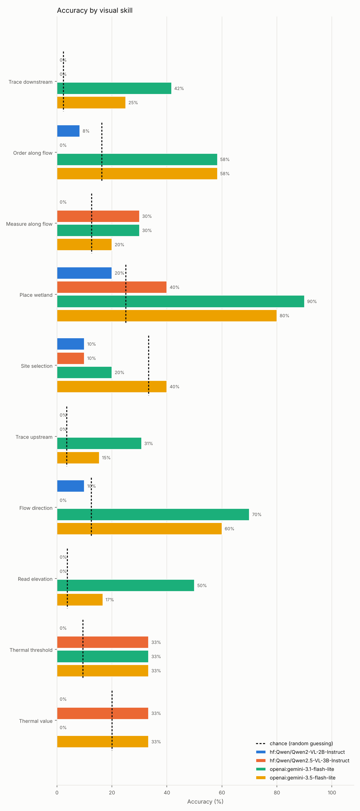

# ThirstMap evaluation report

## Overall

| Model | With image | Without image (blind) | Tasks |
|---|---|---|---|
| hf:Qwen/Qwen2-VL-2B-Instruct | 6% | – | 89 |
| hf:Qwen/Qwen2.5-VL-3B-Instruct | 11% | – | 89 |
| openai:gemini-3.1-flash-lite | 46% | – | 89 |
| openai:gemini-3.5-flash-lite | 39% | – | 89 |

## Better than guessing?

Chance = expected accuracy of a random guesser on exactly these tasks (from each task's options). p = one-sided binomial test that the model beats chance.

| Model | Correct | Accuracy | Chance | p-value |
|---|---|---|---|---|
| hf:Qwen/Qwen2-VL-2B-Instruct | 5/89 | 6% | 14% | 1 |
| hf:Qwen/Qwen2.5-VL-3B-Instruct | 10/89 | 11% | 14% | 0.79 |
| openai:gemini-3.1-flash-lite | 41/89 | 46% | 14% | 1.4e-13 |
| openai:gemini-3.5-flash-lite | 35/89 | 39% | 14% | 1.7e-09 |

### Strict check: well-formed replies only

The scorer is lenient: it accepts a correct answer even when the reply is badly formatted. Counting a reply as right only if it is also well-formed (JSON with "answer", or a plain JSON value):

| Model | Well-formed replies | Accuracy (all) | Accuracy (well-formed only) |
|---|---|---|---|
| hf:Qwen/Qwen2-VL-2B-Instruct | 100% | 6% | 6% |
| hf:Qwen/Qwen2.5-VL-3B-Instruct | 91% | 11% | 11% |
| openai:gemini-3.1-flash-lite | 100% | 46% | 46% |
| openai:gemini-3.5-flash-lite | 100% | 39% | 39% |

## Accuracy by visual skill

Tasks = distinct tasks per skill (every model answers the same ones); with 10-30 tasks per skill, differences of a few points are within noise.

| Skill | Tasks | Chance | hf:Qwen/Qwen2-VL-2B-Instruct | hf:Qwen/Qwen2.5-VL-3B-Instruct | openai:gemini-3.1-flash-lite | openai:gemini-3.5-flash-lite |
|---|---|---|---|---|---|---|
| Trace downstream | 12 | 2% | 0% | 0% | 42% | 25% |
| Order along flow | 12 | 16% | 8% | 0% | 58% | 58% |
| Measure along flow | 10 | 13% | 0% | 30% | 30% | 20% |
| Place wetland | 10 | 25% | 20% | 40% | 90% | 80% |
| Site selection | 10 | 33% | 10% | 10% | 20% | 40% |
| Trace upstream | 13 | 3% | 0% | 0% | 31% | 15% |
| Flow direction | 10 | 12% | 10% | 0% | 70% | 60% |
| Read elevation | 6 | 4% | 0% | 0% | 50% | 17% |
| Thermal threshold | 3 | 9% | 0% | 33% | 33% | 33% |
| Thermal value | 3 | 20% | 0% | 33% | 0% | 33% |

## Eye exam: breaking level (first difficulty where accuracy < 50%)

| Skill | hf:Qwen/Qwen2-VL-2B-Instruct | hf:Qwen/Qwen2.5-VL-3B-Instruct | openai:gemini-3.1-flash-lite | openai:gemini-3.5-flash-lite |
|---|---|---|---|---|
| Trace downstream | 2 | 2 | 4 | 3 |
| Order along flow | 2 | 2 | 4 | 4 |
| Measure along flow | 2 | 2 | 2 | 3 |
| Place wetland | 2 | 3 | >5 | >5 |
| Site selection | 2 | 2 | 3 | 2 |
| Trace upstream | 2 | 2 | 3 | 3 |
| Flow direction | 2 | 2 | >5 | 5 |
| Read elevation | 2 | 2 | >5 | 2 |
| Thermal threshold | 2 | 2 | 2 | 3 |
| Thermal value | 2 | 2 | 2 | 3 |

## Map vs satellite (same scene, same question)

| Model | Pairs | Both right | Only map right | Only satellite right | Both wrong |
|---|---|---|---|---|---|

## Counterfactual pairs (one minimal change that must flip the answer)

Pair accuracy counts a pair only if BOTH the original and its twin are answered correctly. 'Unchanged answer' = the model gave the same answer to both, although the correct answer changed.

| Model | Pairs | Single-task accuracy | Pair accuracy | Unchanged answer |
|---|---|---|---|---|
| hf:Qwen/Qwen2-VL-2B-Instruct | 9 | 6% | 0% | 33% |
| hf:Qwen/Qwen2.5-VL-3B-Instruct | 9 | 11% | 0% | 44% |
| openai:gemini-3.1-flash-lite | 9 | 22% | 0% | 33% |
| openai:gemini-3.5-flash-lite | 9 | 11% | 0% | 22% |

## Traps and error diagnosis

| Model | Trap tasks | Fell for a trap | Most common errors |
|---|---|---|---|
| hf:Qwen/Qwen2-VL-2B-Instruct | 50 | 52% | unparseable_or_no_answer (25), missed_some (18), underestimate (11), trap:downstream_not_upstream (11) |
| hf:Qwen/Qwen2.5-VL-3B-Instruct | 50 | 26% | missed_some (28), unparseable_or_no_answer (14), wrong_choice (13), extra_unrelated (12) |
| openai:gemini-3.1-flash-lite | 50 | 14% | missed_some (13), extra_unrelated (12), wrong_choice (10), overestimate (8) |
| openai:gemini-3.5-flash-lite | 50 | 20% | missed_some (15), extra_unrelated (12), wrong_choice (8), trap:near_but_other_stream (8) |

Tasks a majority of real models answered correctly WITHOUT the image: 0

## Cost

| Model | Input tokens | Output tokens | USD | Mean latency (s) |
|---|---|---|---|---|
| hf:Qwen/Qwen2-VL-2B-Instruct | 0 | 0 | 0 | 33.41 |
| hf:Qwen/Qwen2.5-VL-3B-Instruct | 0 | 0 | 0 | 54.47 |
| openai:gemini-3.1-flash-lite | 0 | 0 | 0 | 7.4 |
| openai:gemini-3.5-flash-lite | 0 | 0 | 0 | 1.44 |

