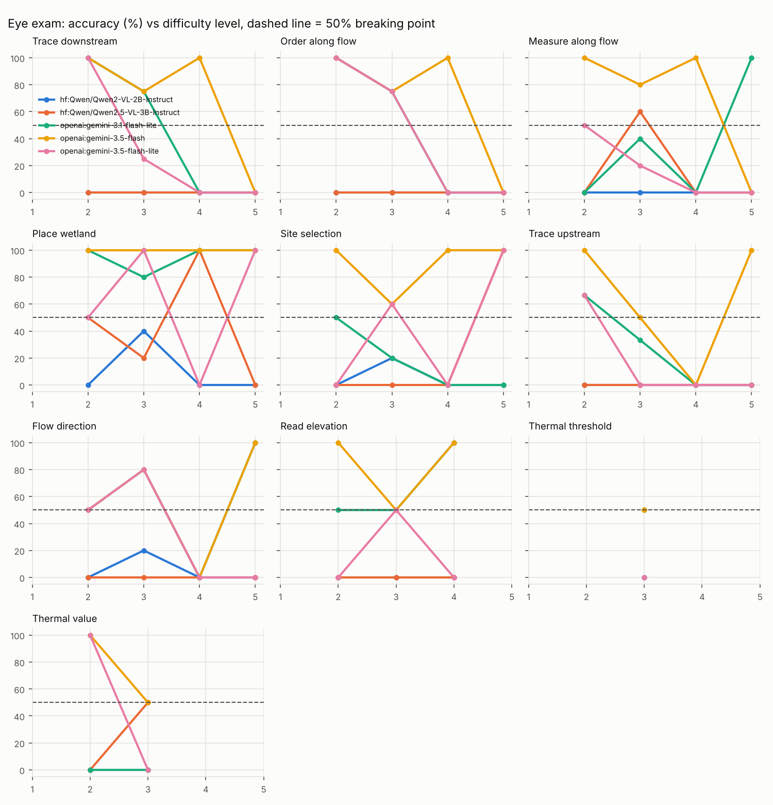

# ThirstMap evaluation report

## Overall

| Model | With image | Without image (blind) | Tasks |
|---|---|---|---|
| hf:Qwen/Qwen2-VL-2B-Instruct | 5% | 11% | 75 |
| hf:Qwen/Qwen2.5-VL-3B-Instruct | 12% | 12% | 75 |
| openai:gemini-3.1-flash-lite | 49% | 13% | 75 |
| openai:gemini-3.5-flash | 76% | – | 75 |
| openai:gemini-3.5-flash-lite | 40% | 15% | 75 |

6 evaluated tasks are left out of every number here: the dataset audit found them unfair (an option label under the scale bar, north arrow or legend, or a malformed scene; docs/AUDIT.md).

All models are compared on the same 75 tasks. Answers to tasks that not every model was given (openai:gemini-3.1-flash-lite: 8, openai:gemini-3.5-flash-lite: 8, hf:Qwen/Qwen2.5-VL-3B-Instruct: 8, hf:Qwen/Qwen2-VL-2B-Instruct: 8, e.g. the original look of an appearance group) are used only in their own section below.

## Better than guessing?

Chance = expected accuracy of a random guesser on exactly these tasks (from each task's options). p = one-sided binomial test that the model beats chance.

| Model | Correct | Accuracy | Chance | p-value |
|---|---|---|---|---|
| hf:Qwen/Qwen2-VL-2B-Instruct | 4/75 | 5% | 14% | 1 |
| hf:Qwen/Qwen2.5-VL-3B-Instruct | 9/75 | 12% | 14% | 0.76 |
| openai:gemini-3.1-flash-lite | 37/75 | 49% | 14% | 6.3e-13 |
| openai:gemini-3.5-flash | 57/75 | 76% | 14% | 4.2e-33 |
| openai:gemini-3.5-flash-lite | 30/75 | 40% | 14% | 4.4e-08 |

### Strict check: well-formed replies only

The scorer is lenient: it accepts a correct answer even when the reply is badly formatted. Counting a reply as right only if it is also well-formed (JSON with "answer", or a plain JSON value):

| Model | Well-formed replies | Accuracy (all) | Accuracy (well-formed only) |
|---|---|---|---|
| hf:Qwen/Qwen2-VL-2B-Instruct | 100% | 5% | 5% |
| hf:Qwen/Qwen2.5-VL-3B-Instruct | 89% | 12% | 12% |
| openai:gemini-3.1-flash-lite | 100% | 49% | 49% |
| openai:gemini-3.5-flash | 100% | 76% | 76% |
| openai:gemini-3.5-flash-lite | 100% | 40% | 40% |

## Accuracy by visual skill

Tasks = distinct tasks per skill (every model answers the same ones); with 10-30 tasks per skill, differences of a few points are within noise.

| Skill | Tasks | Chance | hf:Qwen/Qwen2-VL-2B-Instruct | hf:Qwen/Qwen2.5-VL-3B-Instruct | openai:gemini-3.1-flash-lite | openai:gemini-3.5-flash | openai:gemini-3.5-flash-lite |
|---|---|---|---|---|---|---|---|
| Trace downstream | 9 | 2% | 0% | 0% | 56% | 78% | 33% |
| Order along flow | 9 | 16% | 0% | 0% | 56% | 78% | 56% |
| Measure along flow | 9 | 14% | 0% | 33% | 33% | 78% | 22% |
| Place wetland | 9 | 25% | 22% | 33% | 89% | 100% | 78% |
| Site selection | 9 | 33% | 11% | 11% | 22% | 78% | 44% |
| Trace upstream | 11 | 4% | 0% | 0% | 36% | 64% | 18% |
| Flow direction | 9 | 12% | 11% | 0% | 67% | 67% | 56% |
| Read elevation | 5 | 4% | 0% | 0% | 60% | 80% | 20% |
| Thermal threshold | 2 | 12% | 0% | 50% | 50% | 50% | 0% |
| Thermal value | 3 | 20% | 0% | 33% | 0% | 67% | 33% |

## Eye exam: breaking level (first difficulty where accuracy < 50%)

| Skill | hf:Qwen/Qwen2-VL-2B-Instruct | hf:Qwen/Qwen2.5-VL-3B-Instruct | openai:gemini-3.1-flash-lite | openai:gemini-3.5-flash | openai:gemini-3.5-flash-lite |
|---|---|---|---|---|---|
| Trace downstream | 2 | 2 | 4 | 5 | 3 |
| Order along flow | 2 | 2 | 4 | 5 | 4 |
| Measure along flow | 2 | 2 | 2 | 5 | 3 |
| Place wetland | 2 | 3 | >5 | >5 | 4 |
| Site selection | 2 | 2 | 3 | >5 | 2 |
| Trace upstream | 2 | 2 | 3 | 4 | 3 |
| Flow direction | 2 | 2 | 4 | 4 | 4 |
| Read elevation | 2 | 2 | >5 | >5 | 2 |
| Thermal threshold | 3 | >5 | >5 | >5 | 3 |
| Thermal value | 2 | 2 | 2 | >5 | 3 |

## Map vs satellite (same scene, same question)

| Model | Pairs | Both right | Only map right | Only satellite right | Both wrong |
|---|---|---|---|---|---|

## Counterfactual pairs (one minimal change that must flip the answer)

Pair accuracy counts a pair only if BOTH the original and its twin are answered correctly. 'Unchanged answer' = the model gave the same answer to both, although the correct answer changed.

| Model | Pairs | Single-task accuracy | Pair accuracy | Unchanged answer |
|---|---|---|---|---|
| hf:Qwen/Qwen2-VL-2B-Instruct | 7 | 0% | 0% | 43% |
| hf:Qwen/Qwen2.5-VL-3B-Instruct | 7 | 14% | 0% | 43% |
| openai:gemini-3.1-flash-lite | 7 | 21% | 0% | 14% |
| openai:gemini-3.5-flash | 7 | 71% | 43% | 29% |
| openai:gemini-3.5-flash-lite | 7 | 7% | 0% | 29% |

## Traps and error diagnosis

| Model | Trap tasks | Fell for a trap | Most common errors |
|---|---|---|---|
| hf:Qwen/Qwen2-VL-2B-Instruct | 40 | 55% | unparseable_or_no_answer (21), missed_some (14), underestimate (10), trap:downstream_not_upstream (9) |
| hf:Qwen/Qwen2.5-VL-3B-Instruct | 40 | 28% | missed_some (22), unparseable_or_no_answer (12), wrong_choice (11), extra_unrelated (9) |
| openai:gemini-3.1-flash-lite | 40 | 18% | extra_unrelated (8), missed_some (8), wrong_choice (8), overestimate (7) |
| openai:gemini-3.5-flash | 40 | 8% | extra_unrelated (5), missed_some (3), off_by_one_sector (2), underestimate (2) |
| openai:gemini-3.5-flash-lite | 40 | 20% | missed_some (11), extra_unrelated (10), wrong_choice (7), trap:near_but_other_stream (6) |

Tasks a majority of real models answered correctly WITHOUT the image: 0

## Cost

| Model | Input tokens | Output tokens | USD | Mean latency (s) |
|---|---|---|---|---|
| hf:Qwen/Qwen2-VL-2B-Instruct | 0 | 0 | 0 | 31.08 |
| hf:Qwen/Qwen2.5-VL-3B-Instruct | 0 | 0 | 0 | 51.34 |
| openai:gemini-3.1-flash-lite | 0 | 0 | 0 | 9.26 |
| openai:gemini-3.5-flash | 0 | 0 | 0 | 93.22 |
| openai:gemini-3.5-flash-lite | 0 | 0 | 0 | 1.2 |

