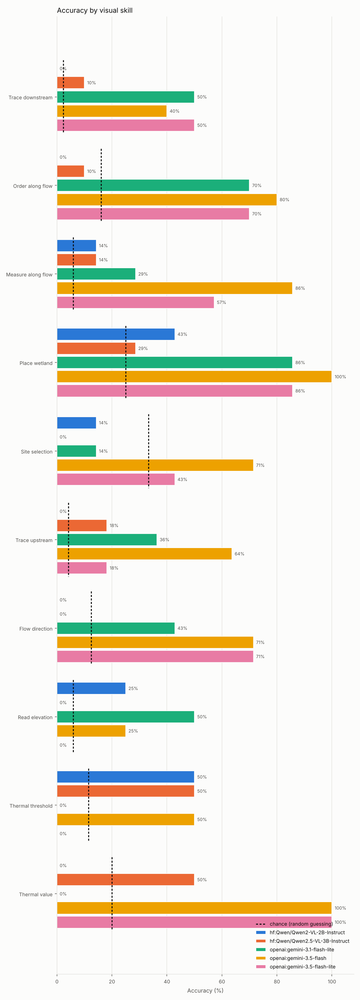
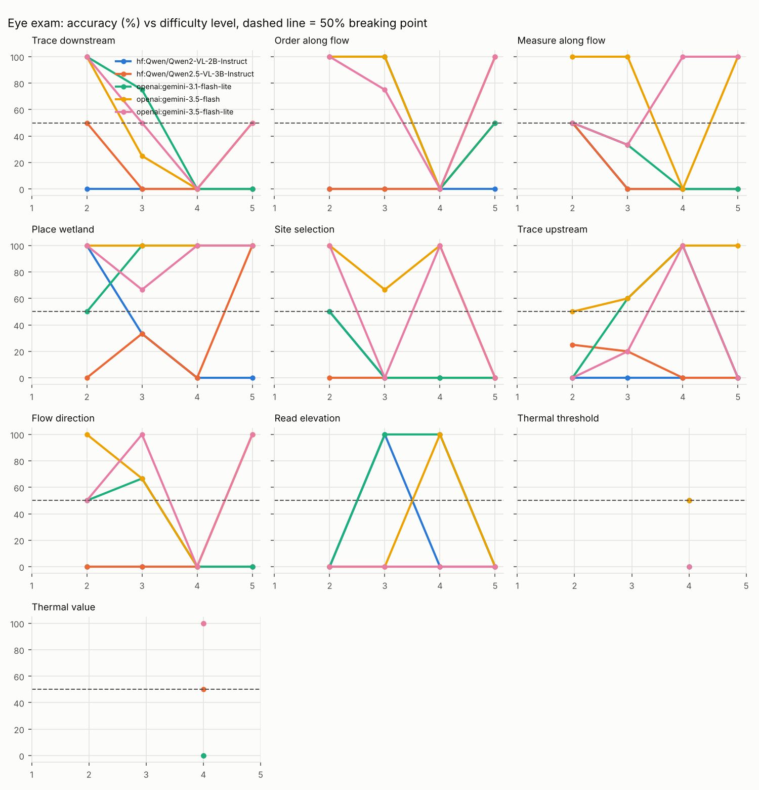
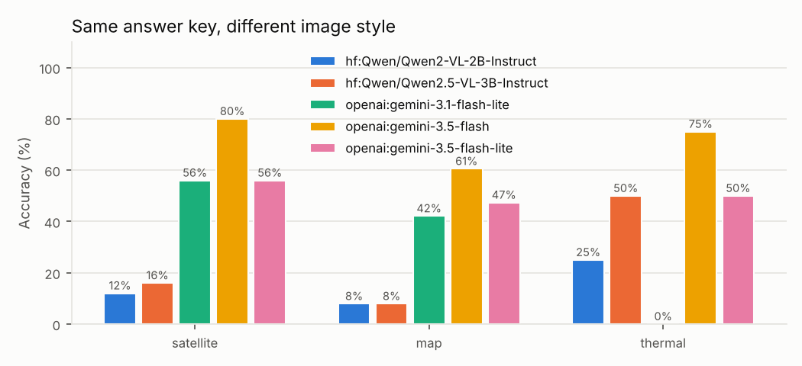

# ThirstMap evaluation report

## Overall

| Model | With image | Without image (blind) | Tasks |
|---|---|---|---|
| hf:Qwen/Qwen2-VL-2B-Instruct | 10% | – | 67 |
| hf:Qwen/Qwen2.5-VL-3B-Instruct | 13% | – | 67 |
| openai:gemini-3.1-flash-lite | 45% | – | 67 |
| openai:gemini-3.5-flash | 69% | – | 67 |
| openai:gemini-3.5-flash-lite | 51% | – | 67 |

## Better than guessing?

Chance = expected accuracy of a random guesser on exactly these tasks (from each task's options). p = one-sided binomial test that the model beats chance.

| Model | Correct | Accuracy | Chance | p-value |
|---|---|---|---|---|
| hf:Qwen/Qwen2-VL-2B-Instruct | 7/67 | 10% | 13% | 0.77 |
| hf:Qwen/Qwen2.5-VL-3B-Instruct | 9/67 | 13% | 13% | 0.49 |
| openai:gemini-3.1-flash-lite | 30/67 | 45% | 13% | 1.1e-10 |
| openai:gemini-3.5-flash | 46/67 | 69% | 13% | 5.4e-26 |
| openai:gemini-3.5-flash-lite | 34/67 | 51% | 13% | 6.9e-14 |

### Strict check: well-formed replies only

The scorer is lenient: it accepts a correct answer even when the reply is badly formatted. Counting a reply as right only if it is also well-formed (JSON with "answer", or a plain JSON value):

| Model | Well-formed replies | Accuracy (all) | Accuracy (well-formed only) |
|---|---|---|---|
| hf:Qwen/Qwen2-VL-2B-Instruct | 100% | 10% | 10% |
| hf:Qwen/Qwen2.5-VL-3B-Instruct | 100% | 13% | 13% |
| openai:gemini-3.1-flash-lite | 100% | 45% | 45% |
| openai:gemini-3.5-flash | 100% | 69% | 69% |
| openai:gemini-3.5-flash-lite | 100% | 51% | 51% |

## Accuracy by visual skill

Tasks = distinct tasks per skill (every model answers the same ones); with 10-30 tasks per skill, differences of a few points are within noise.

| Skill | Tasks | Chance | hf:Qwen/Qwen2-VL-2B-Instruct | hf:Qwen/Qwen2.5-VL-3B-Instruct | openai:gemini-3.1-flash-lite | openai:gemini-3.5-flash | openai:gemini-3.5-flash-lite |
|---|---|---|---|---|---|---|---|
| Trace downstream | 10 | 2% | 0% | 10% | 50% | 40% | 50% |
| Order along flow | 10 | 16% | 0% | 10% | 70% | 80% | 70% |
| Measure along flow | 7 | 6% | 14% | 14% | 29% | 86% | 57% |
| Place wetland | 7 | 25% | 43% | 29% | 86% | 100% | 86% |
| Site selection | 7 | 33% | 14% | 0% | 14% | 71% | 43% |
| Trace upstream | 11 | 4% | 0% | 18% | 36% | 64% | 18% |
| Flow direction | 7 | 12% | 0% | 0% | 43% | 71% | 71% |
| Read elevation | 4 | 6% | 25% | 0% | 50% | 25% | 0% |
| Thermal threshold | 2 | 12% | 50% | 50% | 0% | 50% | 0% |
| Thermal value | 2 | 20% | 0% | 50% | 0% | 100% | 100% |

## Eye exam: breaking level (first difficulty where accuracy < 50%)

| Skill | hf:Qwen/Qwen2-VL-2B-Instruct | hf:Qwen/Qwen2.5-VL-3B-Instruct | openai:gemini-3.1-flash-lite | openai:gemini-3.5-flash | openai:gemini-3.5-flash-lite |
|---|---|---|---|---|---|
| Trace downstream | 2 | 3 | 4 | 3 | 4 |
| Order along flow | 2 | 2 | 4 | 4 | 4 |
| Measure along flow | 3 | 3 | 3 | 4 | 3 |
| Place wetland | 3 | 2 | >5 | >5 | >5 |
| Site selection | 3 | 2 | 3 | 5 | 3 |
| Trace upstream | 2 | 2 | 2 | >5 | 2 |
| Flow direction | 2 | 2 | 4 | 4 | 4 |
| Read elevation | 2 | 2 | 2 | 2 | 2 |
| Thermal threshold | >5 | >5 | 4 | >5 | 4 |
| Thermal value | 4 | >5 | 4 | >5 | >5 |

## Map vs satellite (same scene, same question)

| Model | Pairs | Both right | Only map right | Only satellite right | Both wrong |
|---|---|---|---|---|---|

## Counterfactual pairs (one minimal change that must flip the answer)

Pair accuracy counts a pair only if BOTH the original and its twin are answered correctly. 'Unchanged answer' = the model gave the same answer to both, although the correct answer changed.

| Model | Pairs | Single-task accuracy | Pair accuracy | Unchanged answer |
|---|---|---|---|---|
| hf:Qwen/Qwen2-VL-2B-Instruct | 12 | 4% | 0% | 58% |
| hf:Qwen/Qwen2.5-VL-3B-Instruct | 12 | 21% | 0% | 17% |
| openai:gemini-3.1-flash-lite | 12 | 25% | 8% | 33% |
| openai:gemini-3.5-flash | 12 | 50% | 25% | 17% |
| openai:gemini-3.5-flash-lite | 12 | 29% | 17% | 42% |

## Traps and error diagnosis

| Model | Trap tasks | Fell for a trap | Most common errors |
|---|---|---|---|
| hf:Qwen/Qwen2-VL-2B-Instruct | 40 | 42% | unparseable_or_no_answer (17), trap:downstream_not_upstream (10), missed_some (8), wrong_choice (7) |
| hf:Qwen/Qwen2.5-VL-3B-Instruct | 40 | 28% | missed_some (20), wrong_choice (13), extra_unrelated (11), overestimate (6) |
| openai:gemini-3.1-flash-lite | 40 | 20% | extra_unrelated (8), missed_some (8), wrong_choice (7), overestimate (5) |
| openai:gemini-3.5-flash | 40 | 10% | extra_unrelated (10), missed_some (3), wrong_choice (3), off_by_one_sector (2) |
| openai:gemini-3.5-flash-lite | 40 | 18% | extra_unrelated (9), missed_some (8), wrong_choice (5), trap:near_but_other_stream (4) |

Tasks a majority of real models answered correctly WITHOUT the image: 0

## Cost

| Model | Input tokens | Output tokens | USD | Mean latency (s) |
|---|---|---|---|---|
| hf:Qwen/Qwen2-VL-2B-Instruct | 0 | 0 | 0 | 50.52 |
| hf:Qwen/Qwen2.5-VL-3B-Instruct | 0 | 0 | 0 | 80.94 |
| openai:gemini-3.1-flash-lite | 0 | 0 | 0 | 13.79 |
| openai:gemini-3.5-flash | 0 | 0 | 0 | 40.63 |
| openai:gemini-3.5-flash-lite | 0 | 0 | 0 | 4.42 |

