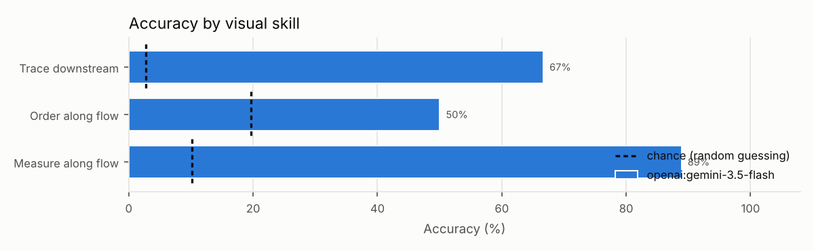
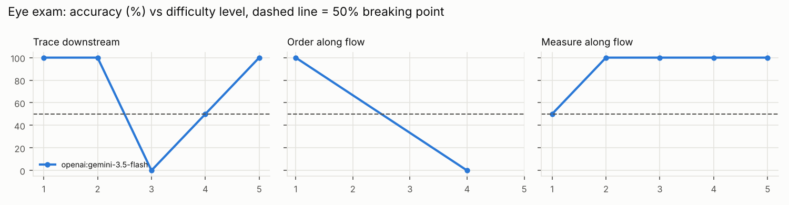
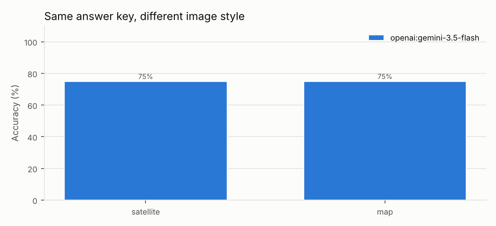

# ThirstMap evaluation report

## Overall

| Model | With image | Without image (blind) | Tasks |
|---|---|---|---|
| openai:gemini-3.5-flash | 75% | – | 20 |

## Better than guessing?

Chance = expected accuracy of a random guesser on exactly these tasks (from each task's options). p = one-sided binomial test that the model beats chance.

| Model | Correct | Accuracy | Chance | p-value |
|---|---|---|---|---|
| openai:gemini-3.5-flash | 15/20 | 75% | 8% | 2.5e-13 |

### Strict check: well-formed replies only

The scorer is lenient: it accepts a correct answer even when the reply is badly formatted. Counting a reply as right only if it is also well-formed (JSON with "answer", or a plain JSON value):

| Model | Well-formed replies | Accuracy (all) | Accuracy (well-formed only) |
|---|---|---|---|
| openai:gemini-3.5-flash | 100% | 75% | 75% |

## Accuracy by visual skill

Tasks = distinct tasks per skill (every model answers the same ones); with 10-30 tasks per skill, differences of a few points are within noise.

| Skill | Tasks | Chance | openai:gemini-3.5-flash |
|---|---|---|---|
| Trace downstream | 9 | 3% | 67% |
| Order along flow | 2 | 20% | 50% |
| Measure along flow | 9 | 10% | 89% |

## Eye exam: breaking level (first difficulty where accuracy < 50%)

| Skill | openai:gemini-3.5-flash |
|---|---|
| Trace downstream | 3 |
| Order along flow | 4 |
| Measure along flow | >5 |

## Map vs satellite (same scene, same question)

| Model | Pairs | Both right | Only map right | Only satellite right | Both wrong |
|---|---|---|---|---|---|

## Counterfactual pairs (one minimal change that must flip the answer)

Pair accuracy counts a pair only if BOTH the original and its twin are answered correctly. 'Unchanged answer' = the model gave the same answer to both, although the correct answer changed.

| Model | Pairs | Single-task accuracy | Pair accuracy | Unchanged answer |
|---|---|---|---|---|

## Traps and error diagnosis

| Model | Trap tasks | Fell for a trap | Most common errors |
|---|---|---|---|
| openai:gemini-3.5-flash | 11 | 9% | missed_some (2), trap:near_but_other_stream (1), extra_unrelated (1), underestimate (1) |

Tasks a majority of real models answered correctly WITHOUT the image: 0

## Cost

| Model | Input tokens | Output tokens | USD | Mean latency (s) |
|---|---|---|---|---|
| openai:gemini-3.5-flash | 23755 | 294 | 0 | 58.71 |

