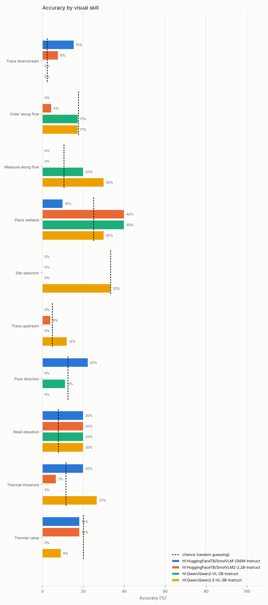
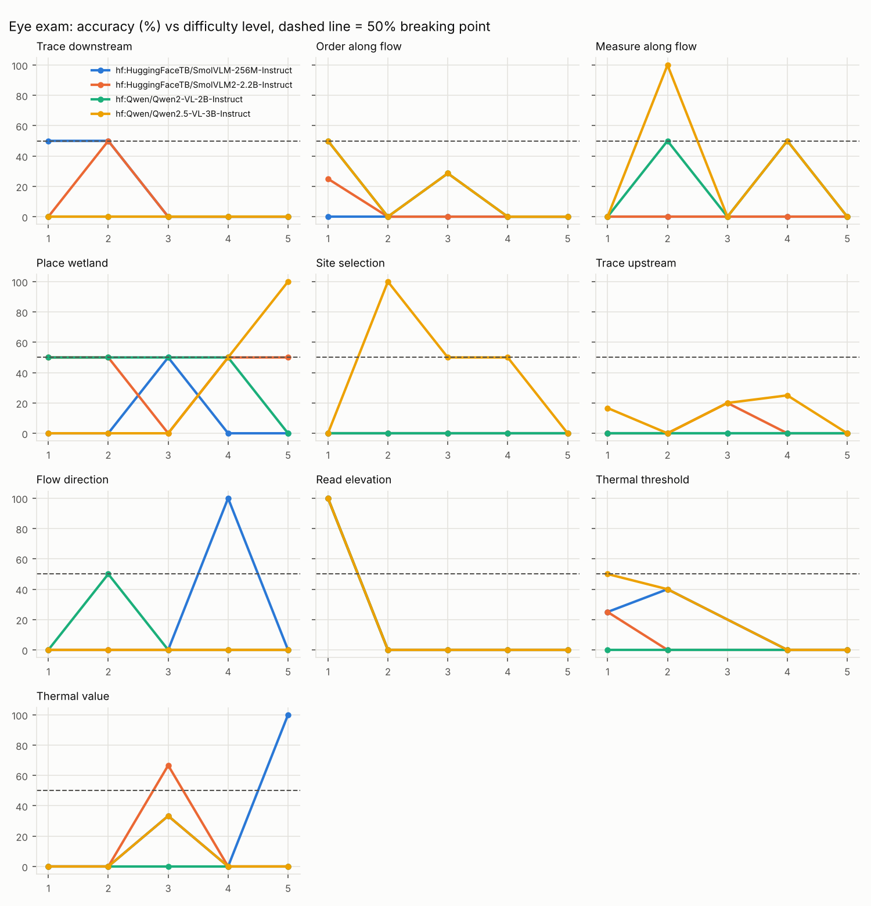
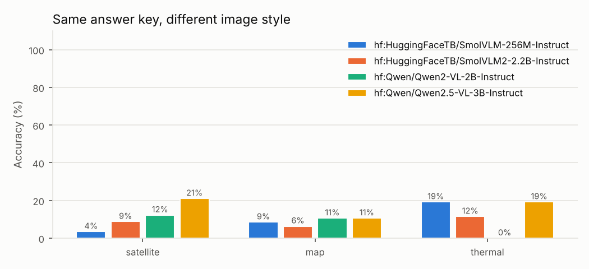

# ThirstMap evaluation report

## Overall

| Model | With image | Without image (blind) | Tasks |
|---|---|---|---|
| hf:HuggingFaceTB/SmolVLM-256M-Instruct | 8% | 10% | 130 |
| hf:HuggingFaceTB/SmolVLM2-2.2B-Instruct | 8% | 12% | 130 |
| hf:Qwen/Qwen2-VL-2B-Instruct | 9% | 9% | 130 |
| hf:Qwen/Qwen2.5-VL-3B-Instruct | 17% | 14% | 130 |

18 evaluated tasks are left out of every number here: the dataset audit found them unfair (an option label under the scale bar, north arrow or legend, or a malformed scene; docs/AUDIT.md).

All models are compared on the same 130 tasks. Answers to tasks that not every model was given (hf:Qwen/Qwen2.5-VL-3B-Instruct: 20, hf:Qwen/Qwen2-VL-2B-Instruct: 20, e.g. the original look of an appearance group) are used only in their own section below.

## Better than guessing?

Chance = expected accuracy of a random guesser on exactly these tasks (from each task's options). p = one-sided binomial test that the model beats chance.

| Model | Correct | Accuracy | Chance | p-value |
|---|---|---|---|---|
| hf:HuggingFaceTB/SmolVLM-256M-Instruct | 11/130 | 8% | 13% | 0.97 |
| hf:HuggingFaceTB/SmolVLM2-2.2B-Instruct | 11/130 | 8% | 13% | 0.97 |
| hf:Qwen/Qwen2-VL-2B-Instruct | 12/130 | 9% | 13% | 0.95 |
| hf:Qwen/Qwen2.5-VL-3B-Instruct | 22/130 | 17% | 13% | 0.15 |

### Strict check: well-formed replies only

The scorer is lenient: it accepts a correct answer even when the reply is badly formatted. Counting a reply as right only if it is also well-formed (JSON with "answer", or a plain JSON value):

| Model | Well-formed replies | Accuracy (all) | Accuracy (well-formed only) |
|---|---|---|---|
| hf:HuggingFaceTB/SmolVLM-256M-Instruct | 27% | 8% | 2% |
| hf:HuggingFaceTB/SmolVLM2-2.2B-Instruct | 90% | 8% | 8% |
| hf:Qwen/Qwen2-VL-2B-Instruct | 92% | 9% | 9% |
| hf:Qwen/Qwen2.5-VL-3B-Instruct | 100% | 17% | 17% |

## Accuracy by visual skill

Tasks = distinct tasks per skill (every model answers the same ones); with 10-30 tasks per skill, differences of a few points are within noise.

| Skill | Tasks | Chance | hf:HuggingFaceTB/SmolVLM-256M-Instruct | hf:HuggingFaceTB/SmolVLM2-2.2B-Instruct | hf:Qwen/Qwen2-VL-2B-Instruct | hf:Qwen/Qwen2.5-VL-3B-Instruct |
|---|---|---|---|---|---|---|
| Trace downstream | 13 | 2% | 15% | 8% | 0% | 0% |
| Order along flow | 23 | 18% | 0% | 4% | 17% | 17% |
| Measure along flow | 10 | 11% | 0% | 0% | 20% | 30% |
| Place wetland | 10 | 25% | 10% | 40% | 40% | 30% |
| Site selection | 9 | 33% | 0% | 0% | 0% | 33% |
| Trace upstream | 25 | 5% | 0% | 4% | 0% | 12% |
| Flow direction | 9 | 12% | 22% | 0% | 11% | 0% |
| Read elevation | 5 | 8% | 20% | 20% | 20% | 20% |
| Thermal threshold | 15 | 11% | 20% | 7% | 0% | 27% |
| Thermal value | 11 | 20% | 18% | 18% | 0% | 9% |

## Eye exam: breaking level (first difficulty where accuracy < 50%)

| Skill | hf:HuggingFaceTB/SmolVLM-256M-Instruct | hf:HuggingFaceTB/SmolVLM2-2.2B-Instruct | hf:Qwen/Qwen2-VL-2B-Instruct | hf:Qwen/Qwen2.5-VL-3B-Instruct |
|---|---|---|---|---|
| Trace downstream | 3 | 1 | 1 | 1 |
| Order along flow | 1 | 1 | 2 | 2 |
| Measure along flow | 1 | 1 | 1 | 1 |
| Place wetland | 1 | 3 | 5 | 1 |
| Site selection | 1 | 1 | 1 | 1 |
| Trace upstream | 1 | 1 | 1 | 1 |
| Flow direction | 1 | 1 | 1 | 1 |
| Read elevation | 2 | 2 | 2 | 2 |
| Thermal threshold | 1 | 1 | 1 | 2 |
| Thermal value | 1 | 1 | 1 | 1 |

## Map vs satellite (same scene, same question)

| Model | Pairs | Both right | Only map right | Only satellite right | Both wrong |
|---|---|---|---|---|---|

## Counterfactual pairs (one minimal change that must flip the answer)

Pair accuracy counts a pair only if BOTH the original and its twin are answered correctly. 'Unchanged answer' = the model gave the same answer to both, although the correct answer changed.

| Model | Pairs | Single-task accuracy | Pair accuracy | Unchanged answer |
|---|---|---|---|---|
| hf:HuggingFaceTB/SmolVLM-256M-Instruct | 26 | 6% | 0% | 73% |
| hf:HuggingFaceTB/SmolVLM2-2.2B-Instruct | 26 | 6% | 0% | 81% |
| hf:Qwen/Qwen2-VL-2B-Instruct | 26 | 6% | 0% | 85% |
| hf:Qwen/Qwen2.5-VL-3B-Instruct | 26 | 19% | 0% | 92% |

## Appearance invariance (same scene and answers, different look)

Each group is one satellite question shown four ways: dry season (original), monsoon, haze, and a coarser sensor. The correct answer never changes, so a robust model answers the same every time.

| Model | Groups | Dry | Monsoon | Haze | Coarse | Same answer in all 4 | Right in all 4 |
|---|---|---|---|---|---|---|---|
| hf:Qwen/Qwen2-VL-2B-Instruct | 20 | 10% | 10% | 10% | 10% | 95% | 10% |
| hf:Qwen/Qwen2.5-VL-3B-Instruct | 20 | 10% | 10% | 10% | 5% | 75% | 5% |

## Perception probes: can the model even read the image?

No reasoning needed: these only ask the model to read what is printed on the image. Low scores here mean failures elsewhere start with perception, not reasoning.

| Probe | hf:HuggingFaceTB/SmolVLM-256M-Instruct | hf:HuggingFaceTB/SmolVLM2-2.2B-Instruct | hf:Qwen/Qwen2-VL-2B-Instruct | hf:Qwen/Qwen2.5-VL-3B-Instruct |
|---|---|---|---|---|
| Read village labels (map) | 0% (n=4) | 100% (n=4) | 100% (n=4) | 50% (n=4) |
| Read village labels (satellite) | 0% (n=4) | 75% (n=4) | 100% (n=4) | 25% (n=4) |
| Read pond spot height (map) | 0% (n=4) | 0% (n=4) | 100% (n=4) | 100% (n=4) |
| Read monitoring labels (thermal) | 0% (n=4) | 100% (n=4) | 75% (n=4) | 100% (n=4) |

## Traps and error diagnosis

| Model | Trap tasks | Fell for a trap | Most common errors |
|---|---|---|---|
| hf:HuggingFaceTB/SmolVLM-256M-Instruct | 86 | 21% | missed_some (46), unparseable_or_no_answer (34), extra_unrelated (9), underestimate (9) |
| hf:HuggingFaceTB/SmolVLM2-2.2B-Instruct | 86 | 50% | unparseable_or_no_answer (30), missed_some (29), trap:downstream_not_upstream (17), underestimate (14) |
| hf:Qwen/Qwen2-VL-2B-Instruct | 86 | 65% | trap:downstream_not_upstream (24), trap:other_stream (15), unparseable_or_no_answer (14), missed_some (13) |
| hf:Qwen/Qwen2.5-VL-3B-Instruct | 86 | 26% | missed_some (45), wrong_choice (18), extra_unrelated (17), overestimate (13) |

Tasks a majority of real models answered correctly WITHOUT the image: 10

## Cost

| Model | Input tokens | Output tokens | USD | Mean latency (s) |
|---|---|---|---|---|
| hf:HuggingFaceTB/SmolVLM-256M-Instruct | 180058 | 7255 | 0 | 10.02 |
| hf:HuggingFaceTB/SmolVLM2-2.2B-Instruct | 217628 | 3554 | 0 | 9.62 |
| hf:Qwen/Qwen2-VL-2B-Instruct | 151933 | 4393 | 0 | 5.99 |
| hf:Qwen/Qwen2.5-VL-3B-Instruct | 151933 | 2573 | 0 | 6.47 |

