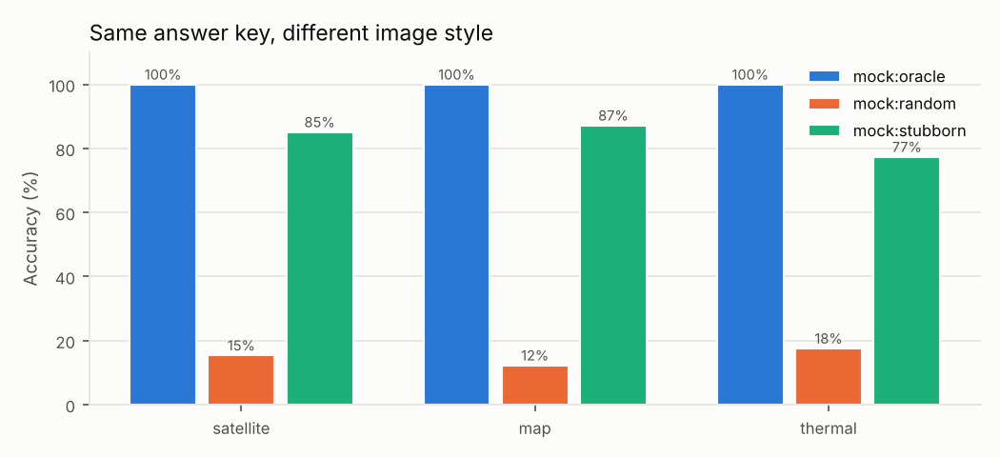

# ThirstMap evaluation report

> **Note:** `mock:*` entries are offline baselines, not AI models: `oracle` returns the answer key (tests the scorer), `random` picks random options (chance level), `stubborn` repeats the original answer on counterfactual twins. Their numbers are expected by construction; see docs/VERIFICATION.md.

## Overall

| Model | With image | Without image (blind) | Tasks |
|---|---|---|---|
| mock:oracle | 100% | 100% | 5761 |
| mock:random | 14% | 14% | 5761 |
| mock:stubborn | 87% | 87% | 5761 |

## Better than guessing?

Chance = expected accuracy of a random guesser on exactly these tasks (from each task's options). p = one-sided binomial test that the model beats chance.

| Model | Correct | Accuracy | Chance | p-value |
|---|---|---|---|---|
| mock:oracle | 5761/5761 | 100% | 14% | 0 |
| mock:random | 788/5761 | 14% | 14% | 0.63 |
| mock:stubborn | 5021/5761 | 87% | 14% | 0 |

## Accuracy by visual skill

| Skill | Chance | mock:oracle | mock:random | mock:stubborn |
|---|---|---|---|---|
| Trace downstream | 3% | 100% | 3% | 79% |
| Order along flow | 17% | 100% | 18% | 79% |
| Measure along flow | 12% | 100% | 11% | 100% |
| Place wetland | 25% | 100% | 24% | 100% |
| Site selection | 33% | 100% | 33% | 100% |
| Trace upstream | 4% | 100% | 4% | 67% |
| Flow direction | 12% | 100% | 11% | 100% |
| Read elevation | 5% | 100% | 5% | 100% |
| Thermal threshold | 10% | 100% | 11% | 76% |
| Thermal value | 20% | 100% | 22% | 83% |

## Eye exam: breaking level (first difficulty where accuracy < 50%)

| Skill | mock:oracle | mock:random | mock:stubborn |
|---|---|---|---|
| Trace downstream | >5 | 1 | >5 |
| Order along flow | >5 | 1 | >5 |
| Measure along flow | >5 | 1 | >5 |
| Place wetland | >5 | 1 | >5 |
| Site selection | >5 | 1 | >5 |
| Trace upstream | >5 | 1 | >5 |
| Flow direction | >5 | 1 | >5 |
| Read elevation | >5 | 1 | >5 |
| Thermal threshold | >5 | 1 | >5 |
| Thermal value | >5 | 1 | >5 |

## Map vs satellite (same scene, same question)

| Model | Pairs | Both right | Only map right | Only satellite right | Both wrong |
|---|---|---|---|---|---|
| mock:oracle | 2434 | 2434 | 0 | 0 | 0 |
| mock:random | 2434 | 72 | 261 | 274 | 1827 |
| mock:stubborn | 2434 | 2125 | 0 | 0 | 309 |

## Counterfactual pairs (one minimal change that must flip the answer)

Pair accuracy counts a pair only if BOTH the original and its twin are answered correctly. 'Unchanged answer' = the model gave the same answer to both, although the correct answer changed.

| Model | Pairs | Single-task accuracy | Pair accuracy | Unchanged answer |
|---|---|---|---|---|
| mock:oracle | 740 | 100% | 100% | 0% |
| mock:random | 740 | 9% | 1% | 7% |
| mock:stubborn | 740 | 50% | 0% | 100% |

## Traps and error diagnosis

| Model | Trap tasks | Fell for a trap | Most common errors |
|---|---|---|---|
| mock:oracle | 3375 | 0% | – |
| mock:random | 3375 | 44% | missed_some (1722), wrong_choice (1043), extra_unrelated (759), overestimate (595) |
| mock:stubborn | 3375 | 1% | extra_unrelated (476), missed_some (350), wrong_choice (119), overestimate (45) |

Tasks a majority of real models answered correctly WITHOUT the image: 0

## Cost

| Model | Input tokens | Output tokens | USD | Mean latency (s) |
|---|---|---|---|---|
| mock:oracle | 0 | 0 | 0 | 0.0 |
| mock:random | 0 | 0 | 0 | 0.0 |
| mock:stubborn | 0 | 0 | 0 | 0.0 |

