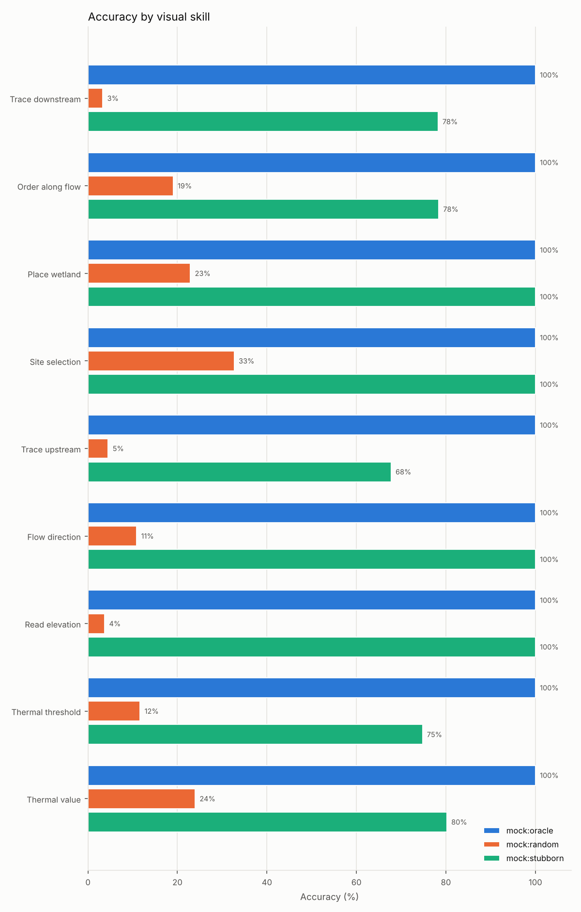

# ThirstMap evaluation report

## Overall

| Model | With image | Without image (blind) | Tasks |
|---|---|---|---|
| mock:oracle | 100% | 100% | 1784 |
| mock:random | 14% | 12% | 1784 |
| mock:stubborn | 85% | 85% | 1784 |

## Accuracy by visual skill

| Skill | mock:oracle | mock:random | mock:stubborn |
|---|---|---|---|
| Trace downstream | 100% | 3% | 78% |
| Order along flow | 100% | 19% | 78% |
| Place wetland | 100% | 23% | 100% |
| Site selection | 100% | 33% | 100% |
| Trace upstream | 100% | 5% | 68% |
| Flow direction | 100% | 11% | 100% |
| Read elevation | 100% | 4% | 100% |
| Thermal threshold | 100% | 12% | 75% |
| Thermal value | 100% | 24% | 80% |

## Eye exam: breaking level (first difficulty where accuracy < 50%)

| Skill | mock:oracle | mock:random | mock:stubborn |
|---|---|---|---|
| Trace downstream | >5 | 1 | >5 |
| Order along flow | >5 | 1 | >5 |
| Place wetland | >5 | 1 | >5 |
| Site selection | >5 | 2 | >5 |
| Trace upstream | >5 | 1 | >5 |
| Flow direction | >5 | 1 | >5 |
| Read elevation | >5 | 1 | >5 |
| Thermal threshold | >5 | 1 | >5 |
| Thermal value | >5 | 1 | >5 |

## Map vs satellite (same scene, same question)

| Model | Pairs | Both right | Only map right | Only satellite right | Both wrong |
|---|---|---|---|---|---|
| mock:oracle | 738 | 738 | 0 | 0 | 0 |
| mock:random | 738 | 26 | 74 | 88 | 550 |
| mock:stubborn | 738 | 630 | 0 | 0 | 108 |

## Counterfactual pairs (one minimal change that must flip the answer)

Pair accuracy counts a pair only if BOTH the original and its twin are answered correctly. 'Unchanged answer' = the model gave the same answer to both, although the correct answer changed.

| Model | Pairs | Single-task accuracy | Pair accuracy | Unchanged answer |
|---|---|---|---|---|
| mock:oracle | 263 | 100% | 100% | 0% |
| mock:random | 263 | 10% | 2% | 7% |
| mock:stubborn | 263 | 50% | 0% | 100% |

## Traps and error diagnosis

| Model | Trap tasks | Fell for a trap | Most common errors |
|---|---|---|---|
| mock:oracle | 1171 | 0% | – |
| mock:random | 1171 | 44% | missed_some (595), wrong_choice (361), extra_unrelated (272), trap:downstream_not_upstream (178) |
| mock:stubborn | 1171 | 1% | extra_unrelated (169), missed_some (123), wrong_choice (47), overestimate (19) |

Tasks a majority of real models answered correctly WITHOUT the image: 0

## Cost

| Model | Input tokens | Output tokens | USD | Mean latency (s) |
|---|---|---|---|---|
| mock:oracle | 0 | 0 | 0 | 0.0 |
| mock:random | 0 | 0 | 0 | 0.0 |
| mock:stubborn | 0 | 0 | 0 | 0.0 |

