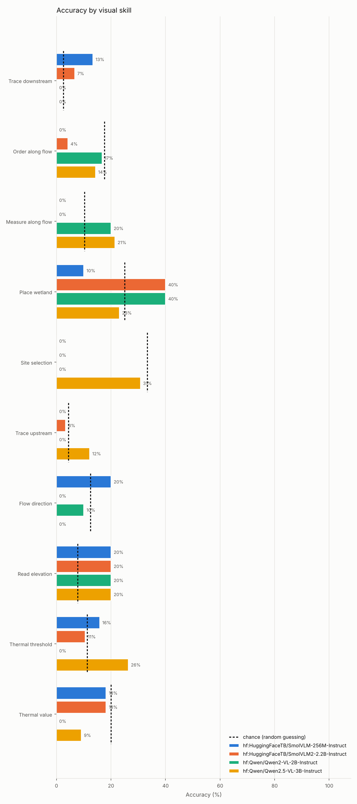
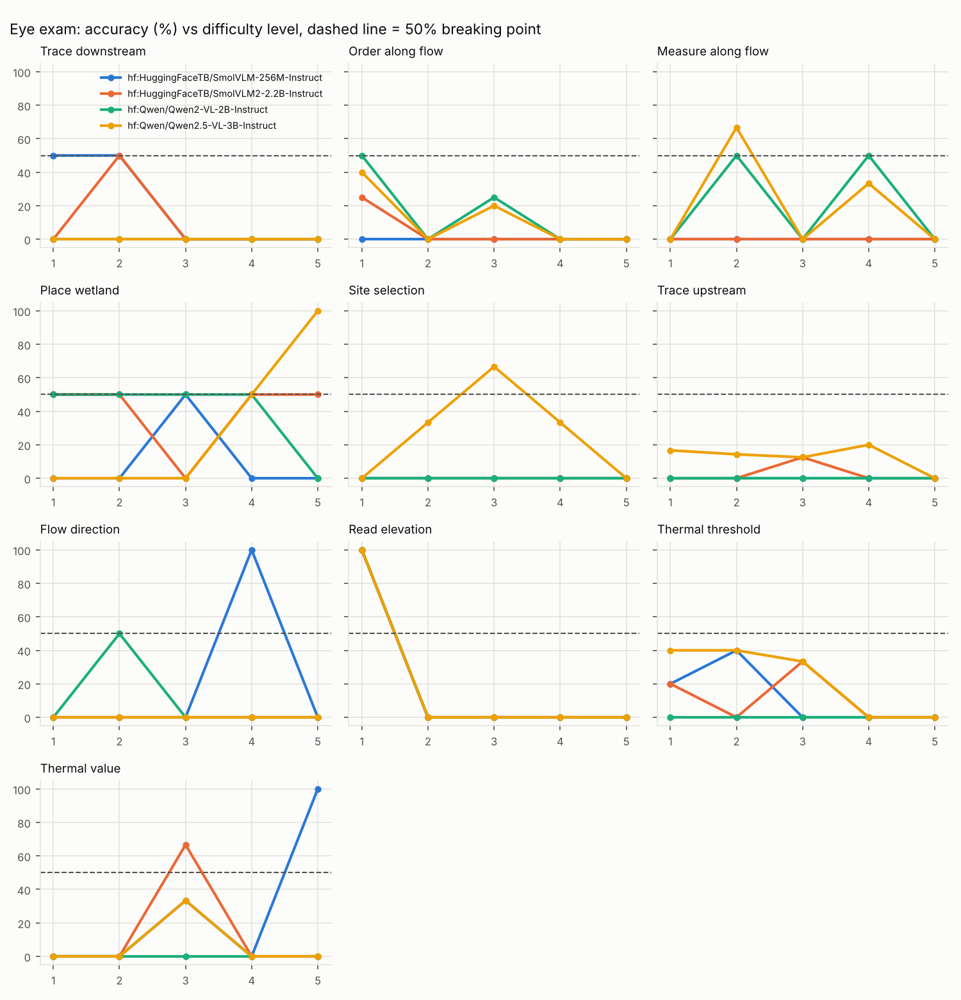
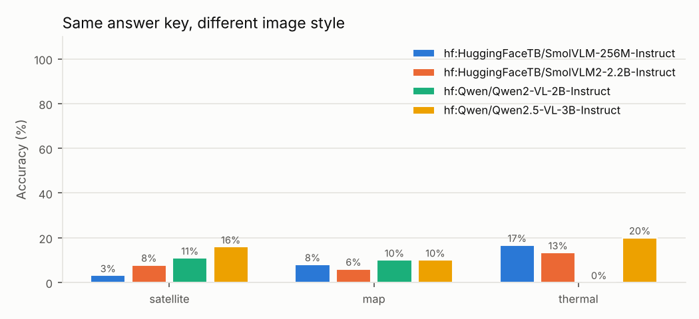

# ThirstMap evaluation report

## Overall

| Model | With image | Without image (blind) | Tasks |
|---|---|---|---|
| hf:HuggingFaceTB/SmolVLM-256M-Instruct | 8% | 10% | 144 |
| hf:HuggingFaceTB/SmolVLM2-2.2B-Instruct | 8% | 12% | 144 |
| hf:Qwen/Qwen2-VL-2B-Instruct | 8% | 9% | 144 |
| hf:Qwen/Qwen2.5-VL-3B-Instruct | 15% | 13% | 168 |

## Better than guessing?

Chance = expected accuracy of a random guesser on exactly these tasks (from each task's options). p = one-sided binomial test that the model beats chance.

| Model | Correct | Accuracy | Chance | p-value |
|---|---|---|---|---|
| hf:HuggingFaceTB/SmolVLM-256M-Instruct | 11/144 | 8% | 13% | 0.99 |
| hf:HuggingFaceTB/SmolVLM2-2.2B-Instruct | 12/144 | 8% | 13% | 0.97 |
| hf:Qwen/Qwen2-VL-2B-Instruct | 12/144 | 8% | 13% | 0.97 |
| hf:Qwen/Qwen2.5-VL-3B-Instruct | 25/168 | 15% | 13% | 0.29 |

## Accuracy by visual skill

Tasks = distinct tasks per skill (every model answers the same ones); with 10-30 tasks per skill, differences of a few points are within noise.

| Skill | Tasks | Chance | hf:HuggingFaceTB/SmolVLM-256M-Instruct | hf:HuggingFaceTB/SmolVLM2-2.2B-Instruct | hf:Qwen/Qwen2-VL-2B-Instruct | hf:Qwen/Qwen2.5-VL-3B-Instruct |
|---|---|---|---|---|---|---|
| Trace downstream | 19 | 2% | 13% | 7% | 0% | 0% |
| Order along flow | 28 | 18% | 0% | 4% | 17% | 14% |
| Measure along flow | 14 | 10% | 0% | 0% | 20% | 21% |
| Place wetland | 13 | 25% | 10% | 40% | 40% | 23% |
| Site selection | 13 | 33% | 0% | 0% | 0% | 31% |
| Trace upstream | 33 | 4% | 0% | 3% | 0% | 12% |
| Flow direction | 13 | 12% | 20% | 0% | 10% | 0% |
| Read elevation | 5 | 8% | 20% | 20% | 20% | 20% |
| Thermal threshold | 19 | 11% | 16% | 11% | 0% | 26% |
| Thermal value | 11 | 20% | 18% | 18% | 0% | 9% |

## Eye exam: breaking level (first difficulty where accuracy < 50%)

| Skill | hf:HuggingFaceTB/SmolVLM-256M-Instruct | hf:HuggingFaceTB/SmolVLM2-2.2B-Instruct | hf:Qwen/Qwen2-VL-2B-Instruct | hf:Qwen/Qwen2.5-VL-3B-Instruct |
|---|---|---|---|---|
| Trace downstream | 3 | 1 | 1 | 1 |
| Order along flow | 1 | 1 | 2 | 1 |
| Measure along flow | 1 | 1 | 1 | 1 |
| Place wetland | 1 | 3 | 5 | 1 |
| Site selection | 1 | 1 | 1 | 1 |
| Trace upstream | 1 | 1 | 1 | 1 |
| Flow direction | 1 | 1 | 1 | 1 |
| Read elevation | 2 | 2 | 2 | 2 |
| Thermal threshold | 1 | 1 | 1 | 1 |
| Thermal value | 1 | 1 | 1 | 1 |

## Map vs satellite (same scene, same question)

| Model | Pairs | Both right | Only map right | Only satellite right | Both wrong |
|---|---|---|---|---|---|

## Counterfactual pairs (one minimal change that must flip the answer)

Pair accuracy counts a pair only if BOTH the original and its twin are answered correctly. 'Unchanged answer' = the model gave the same answer to both, although the correct answer changed.

| Model | Pairs | Single-task accuracy | Pair accuracy | Unchanged answer |
|---|---|---|---|---|
| hf:HuggingFaceTB/SmolVLM-256M-Instruct | 30 | 5% | 0% | 73% |
| hf:HuggingFaceTB/SmolVLM2-2.2B-Instruct | 30 | 7% | 0% | 77% |
| hf:Qwen/Qwen2-VL-2B-Instruct | 30 | 5% | 0% | 87% |
| hf:Qwen/Qwen2.5-VL-3B-Instruct | 30 | 18% | 0% | 87% |

## Appearance invariance (same scene and answers, different look)

Each group is one satellite question shown four ways: dry season (original), monsoon, haze, and a coarser sensor. The correct answer never changes, so a robust model answers the same every time.

| Model | Groups | Dry | Monsoon | Haze | Coarse | Same answer in all 4 | Right in all 4 |
|---|---|---|---|---|---|---|---|
| hf:Qwen/Qwen2.5-VL-3B-Instruct | 24 | 8% | 8% | 8% | 4% | 75% | 4% |

## Perception probes: can the model even read the image?

No reasoning needed: these only ask the model to read what is printed on the image. Low scores here mean failures elsewhere start with perception, not reasoning.

| Probe | hf:HuggingFaceTB/SmolVLM-256M-Instruct | hf:HuggingFaceTB/SmolVLM2-2.2B-Instruct | hf:Qwen/Qwen2-VL-2B-Instruct | hf:Qwen/Qwen2.5-VL-3B-Instruct |
|---|---|---|---|---|
| Read village labels (map) | 0% (n=4) | 100% (n=4) | 100% (n=4) | 50% (n=4) |
| Read village labels (satellite) | 0% (n=4) | 75% (n=4) | 100% (n=4) | 25% (n=4) |
| Read pond spot height (map) | 0% (n=4) | 0% (n=4) | 100% (n=4) | 100% (n=4) |
| Read monitoring labels (thermal) | 0% (n=4) | 100% (n=4) | 75% (n=4) | 100% (n=4) |

## Traps and error diagnosis

| Model | Trap tasks | Fell for a trap | Most common errors |
|---|---|---|---|
| hf:HuggingFaceTB/SmolVLM-256M-Instruct | 98 | 18% | missed_some (56), unparseable_or_no_answer (36), extra_unrelated (11), underestimate (9) |
| hf:HuggingFaceTB/SmolVLM2-2.2B-Instruct | 98 | 51% | missed_some (34), unparseable_or_no_answer (32), trap:downstream_not_upstream (21), underestimate (14) |
| hf:Qwen/Qwen2-VL-2B-Instruct | 98 | 66% | trap:downstream_not_upstream (29), trap:other_stream (18), missed_some (16), unparseable_or_no_answer (15) |
| hf:Qwen/Qwen2.5-VL-3B-Instruct | 112 | 27% | missed_some (58), wrong_choice (25), extra_unrelated (24), overestimate (16) |

Tasks a majority of real models answered correctly WITHOUT the image: 11

## Cost

| Model | Input tokens | Output tokens | USD | Mean latency (s) |
|---|---|---|---|---|
| hf:HuggingFaceTB/SmolVLM-256M-Instruct | 199768 | 8185 | 0 | 9.73 |
| hf:HuggingFaceTB/SmolVLM2-2.2B-Instruct | 241384 | 4109 | 0 | 9.72 |
| hf:Qwen/Qwen2-VL-2B-Instruct | 168420 | 5055 | 0 | 6.05 |
| hf:Qwen/Qwen2.5-VL-3B-Instruct | 192151 | 3087 | 0 | 7.14 |

